# Decorations under a list transform (lane `decorate-transform`)

Branch `me/decorate-transform` from `origin/prism-me` (after #28). Worktree `~/prism-me-lanes/decorate-transform`. Dev
port 1363.

## Why (Ludo, 2026-10-31)

Ludo loads `cryoet-ribosomes.ndjson`, fetches 2PLV (assembly 1), sets the list's Scale (Position) to 10 Å/unit, then
decorates Target 0 with 2PLV, from the pull-down or the PDB id field. Both fail with "Target does not apply to CryoET
Data Portal particles". Decorating first, then scaling, works, but then zooming in makes everything disappear.

## What is known (reproduced headless on 1343)

1. **Decorating after a scale.** `stage.scale` adds `ParticleListTransform`, a decorator, on the list
   (`packages/plugin/core/src/state/transforms/particles/ops.ts`). `cryoet.decorate` then inserts
   `ParticleListWithTargets` under it. `ParticleListTransform.update` returns Unchanged when its params and
   `b.data.sourceData === a.data.sourceData` are the same. Its output keeps the list without `targetMapping`, so
   `ensureTargetRepresentation` adds a `target` representation that is not applicable. Script:
   `~/prism-me-lanes/deco12.cjs` (`node deco12.cjs 1343`).
2. **Decorating, then scaling, then zooming in.** The camera's bounds are the scaled list's (radius 6,124 Å).
   - WebGPU: the decorations do not show at all after the scale; only the 2PLV structure shows, in a corner.
   - WebGL2: the decorations show scaled, then vanish once the camera moves in (0.3 of the distance).
   - Render objects after the scale (`clip2.cjs`): one at center (161, 179, 190), radius 309, which is likely stale
     bounds from before the scale.

   Not known: which object that is; whether #28's per-instance or cluster culling (instance spheres, cluster bounds,
   draw lists) also keeps old data; whether this happened before #28. Scripts: `~/prism-me-lanes/clip1.cjs` and
   `clip2.cjs` (`node clip1.cjs webgpu|webgl2`); edit their port.

## Do

1. A test that fails first for (1). Then the fix: `ParticleListTransform` updates whenever its input list changed (the
   same data or not), still Unchanged when neither its params nor its input changed. Check `ParticleListOffsets` and the
   other particle decorators for the same short cut.
2. Find why the decorations' bounds go stale after a list transform (target representation, its instances, bounding
   sphere, invariant bounding sphere; #28's per-instance spheres and cluster bounds; CPU culling). Write a test that
   fails first, then fix. Also cover a move or turn of the list (handles), not only the scale.
3. Ludo's exact steps headless, on WebGPU and WebGL2:
   - decorate after a scale;
   - scale after decorating;
   - zoom to 0.3, 0.1 and 0.03 toward a decorated particle;
   - move the list with the handles.

   Screenshots in this progress file; nothing may disappear.

4. Say whether each bug is in 5.x or upstream v6 too (library fixes go upstream later).

## Rules

- Never rebase; merge. Never push to upstream molstar/molstar.
- Commit messages say "Ludo" and end with `Co-Authored-By: Claude Opus 5.5 <noreply@anthropic.com>`. Push after each
  commit.
- Tests with `--maxWorkers=2`, no parallel suites. Stop your dev server when done.
- Do not touch `current.md`.
- The gate before the PR:
  - `npx tsc -b`;
  - `npx tsc --noEmit -p apps/prism-me`;
  - lint and format:check;
  - `node scripts/workspace/assets.mjs`, then check:workspace;
  - the unit tests of the packages touched;
  - test:scaling;
  - styles:check and typecheck:storybook.

  Then the lane-reviewer, then the lane-skeptic.

- Then `gh pr create -R corredD/molstar-proto --base prism-me`. The PR body ends with
  `🤖 Generated with [Claude Code](https://claude.com/claude-code)`. Do not merge.

## Built (2026-10-31)

Four causes, not two: Ludo's two bugs, and two more found on the way through his steps. Each with a test that failed
first, each its own commit.

| #   | What Ludo saw                                                 | Cause                                                                                                                                                                                                                                                                                                                                                                                                                                                                  | Fix                                                                                                                                                                                 | Test (failed first)                                                                                                                                                                         |
| --- | ------------------------------------------------------------- | ---------------------------------------------------------------------------------------------------------------------------------------------------------------------------------------------------------------------------------------------------------------------------------------------------------------------------------------------------------------------------------------------------------------------------------------------------------------------- | ----------------------------------------------------------------------------------------------------------------------------------------------------------------------------------- | ------------------------------------------------------------------------------------------------------------------------------------------------------------------------------------------- |
| 1   | decorating after a scale: "Target does not apply to …"        | `cryoet.decorate` inserts `ParticleListWithTargets` right under the list, above the scale's `ParticleListTransform`. Its `update` returned Unchanged on equal params and equal `sourceData`, which a decoration keeps. Its output kept the list without `targetMapping`. `ParticleListOffsets` had the same short cut                                                                                                                                                  | both compare the input list itself, kept in their cache (as `ModelWithCoordinates` does); Unchanged only when neither params nor input changed (a03c1c952)                          | `with-targets.test.ts`: a decoration inserted above the transform and above the offsets reaches their output; same params and input: the same list                                          |
| 2   | decorated, then scaled: everything disappears when zooming in | the target visual's in-place update (`common.ts`, `updateMatrix`) rebuilt the instance transforms and grid but kept the render object's bounding sphere, where the particles were (`// TODO … geomUtils is too slow`, commented out). The camera's near and far planes and the culling came from the stale sphere                                                                                                                                                      | `geomUtils.updateBoundingSphere` after the transforms (and sizes), as `createValues` makes it: the geometry's cached sphere and the instances' transforms, O(instances) (e91553839) | `target-bounds.test.ts`: updated with a list scaled, then also moved and turned, the bounds equal a fresh repr's on that list; one target, and two targets merged                           |
| 3   | WebGPU: the decorations not shown at all after the scale      | on WebGPU the target objects are merged for the GPU culling (a merged object even for one target). Decorated, then scaled at once (no frame between, as Ludo's script and an agent do): the merged object was made from its members before the scale, the scene added it a frame later, and its renderable was made from the values as merged. `mergeRenderObjectsByType` kept it (same members) and only a renderable's `update` syncs it, which an add does not call | the kept merged object is synced when kept (`merged.sync()`: version checks, the work its renderable's update would do) (9ec9bf2d5)                                                 | `target-bounds.test.ts`: a merged object kept by an update has its members' transforms and bounds before any renderable syncs it                                                            |
| 4   | (found running his steps) scaled, decorated, then moved: gone | stage-tools' `decoratorUnder` looked for the list's `ParticleListTransform` right under the list; after a decoration it is under the decoration. `stage.scale` and `stage.move` then added a second transform under the first: a scale of 10 again made 100, a move of 1,500 Å became 15,000 Å, the list thrown out of view                                                                                                                                            | `decoratorUnder` walks the chain of decorators, as cryoet's `decoratorCell` does (f40fef555)                                                                                        | `apps/prism-me/src/_test/decorate-transform.test.ts`: scale, decorate, scale again (the same), move (not scaled), one transform; and decorate, scale, move, preview: every particle bounded |

`ParticleRepresentation3DLayers.update` also keys on `sourceData`. It is right there: the layers' state comes from the
source's rows only. Not changed. The volume decorators (`VolumeTransform`, `VolumeInstances`) have no `update` (they are
recreated). `ModelWithCoordinates` already keys on its input.

#28's per-instance and cluster culling keeps no old data: the culler's layout is keyed on the members' `instanceGrid`
and `boundingSphere` versions, which the in-place update bumps; with the fixes every step draws on WebGPU.

### Upstream, 5.x, #28

- 1 and 4: prism-me's own (`ParticleListTransform`, `ParticleListOffsets` and stage-tools are Ludo's, 2026-10-19 and
  after; not in upstream/master).
- 2: upstream v6 (`packages/graphics/.../target/common.ts`, Alexander, 2026-08-11) and 5.x
  (`src/mol-repr/particles/ representation/target/common.ts`, the same TODO). Before #28. `CHANGELOG.md` has its line.
- 3: upstream v6: the merged objects kept by `mergeRenderObjectsByType` and the GPU-culled merge of one group
  (Alexander, 2026-10-24, v6 graphics), before #28. 5.x keeps merged objects the same way (`src/mol-repr/merged.ts`) but
  merges only two or more; likely there too, with two targets decorated, not reproduced there. `CHANGELOG.md` has its
  line.
- The library fixes (2, 3) are each one commit with only `packages/graphics` files, their test and the `CHANGELOG.md`
  line, to cherry-pick onto a lane from master when Ludo says so. Decision (brief: fix here, upstream later; AGENTS.md:
  a library fix is a lane from master): fixed here, kept cherry-pickable, no master lane opened.

### Ludo's steps, headless (port 1363)

`cryoet-ribosomes.ndjson`, 2PLV assembly 1, Scale 10 Å/unit, target 0 decorated with the 2PLV structure, in both orders,
with no frame between the two steps; camera reset; zoom to 0.3, 0.1 and 0.03 of the distance toward the target-0
particle nearest the view's center; then the list moved 1,500 Å in x (`stage.move`, what a handle's release commits) and
zoomed to 0.1 toward the moved particle. Chrome headless, WebGPU and WebGL2 (`?graphics-backend=webgl2`). The share of
the window not background (the UI alone is 2.9%), before (origin/prism-me) → after:

| Step                        | WebGL2 before → after       | WebGPU before → after          |
| --------------------------- | --------------------------- | ------------------------------ |
| scale, then decorate        | decorate fails → ok         | decorate fails → ok            |
| decorate, then scale: reset | 8.8 → 8.7                   | 3.2 (unscaled, a corner) → 8.7 |
| … zoom 0.3                  | 2.9 (nothing) → 25.3        | 2.9 (nothing) → 25.3           |
| … zoom 0.1                  | 2.9 (nothing) → 28.5        | 2.9 (nothing) → 28.5           |
| … zoom 0.03                 | 2.9 (nothing) → 88.5        | 2.9 (nothing) → 88.4           |
| … moved, zoom 0.1           | 99.9 → 100                  | 99.9 → 100                     |
| scale, then decorate: reset | 10.1 (no decoration) → 8.6  | 10.1 (no decoration) → 8.6     |
| … zoom 0.1                  | 97.5 (no decoration) → 94.5 | 97.5 (no decoration) → 94.5    |
| … moved, zoom 0.1           | 100 (no decoration) → 99.9  | 100 (no decoration) → 99.9     |

Nothing disappears after the fixes, on either backend.

| Decorate, then scale | Before                                                                        | After                                                                        |
| -------------------- | ----------------------------------------------------------------------------- | ---------------------------------------------------------------------------- |
| WebGL2, reset        | 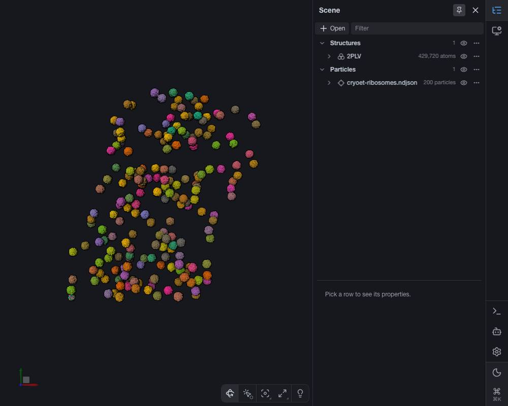     | 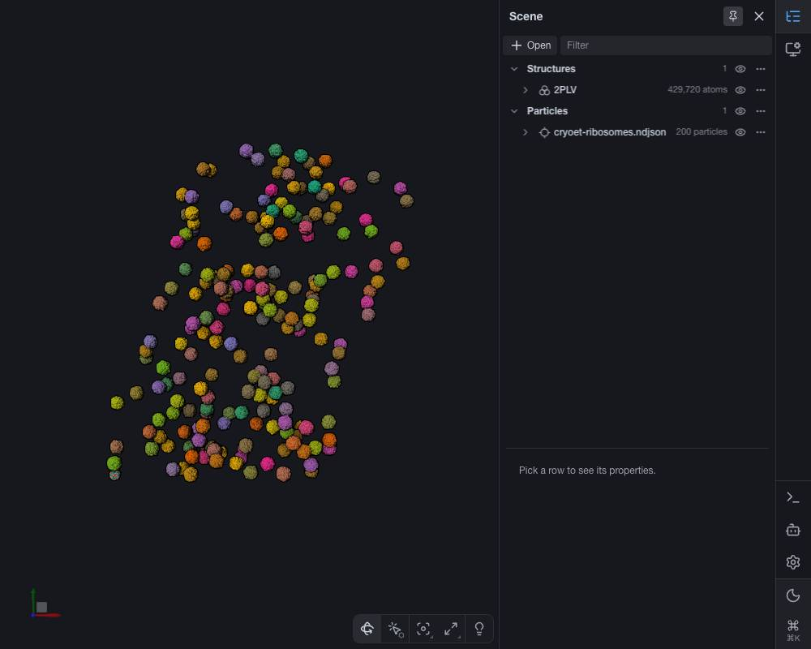     |
| WebGL2, zoom 0.3     |   | 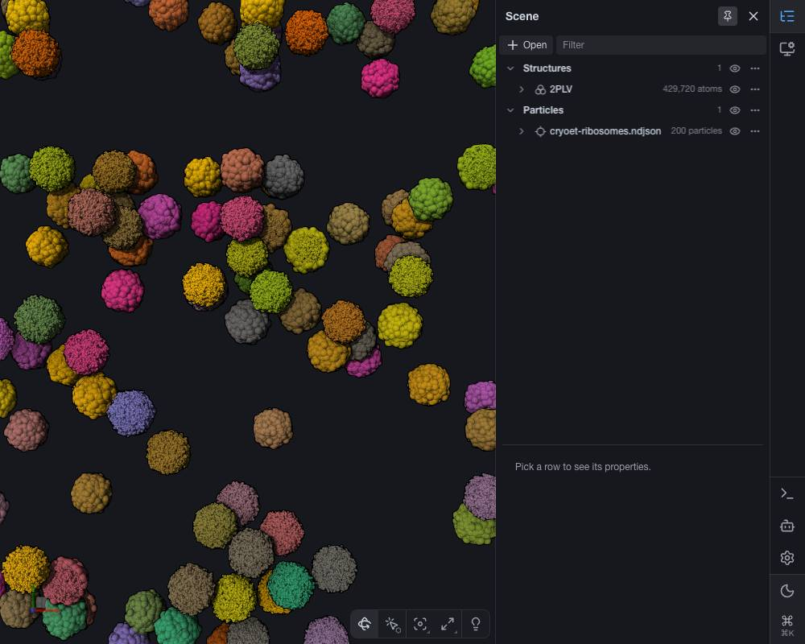  |
| WebGL2, zoom 0.03    | 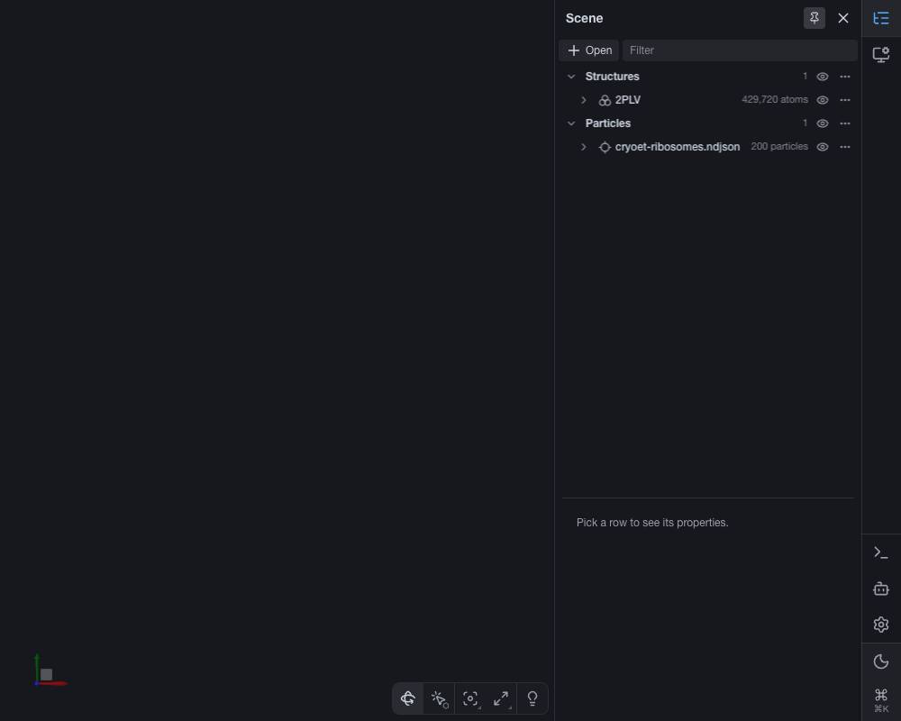 |  |
| WebGPU, reset        | 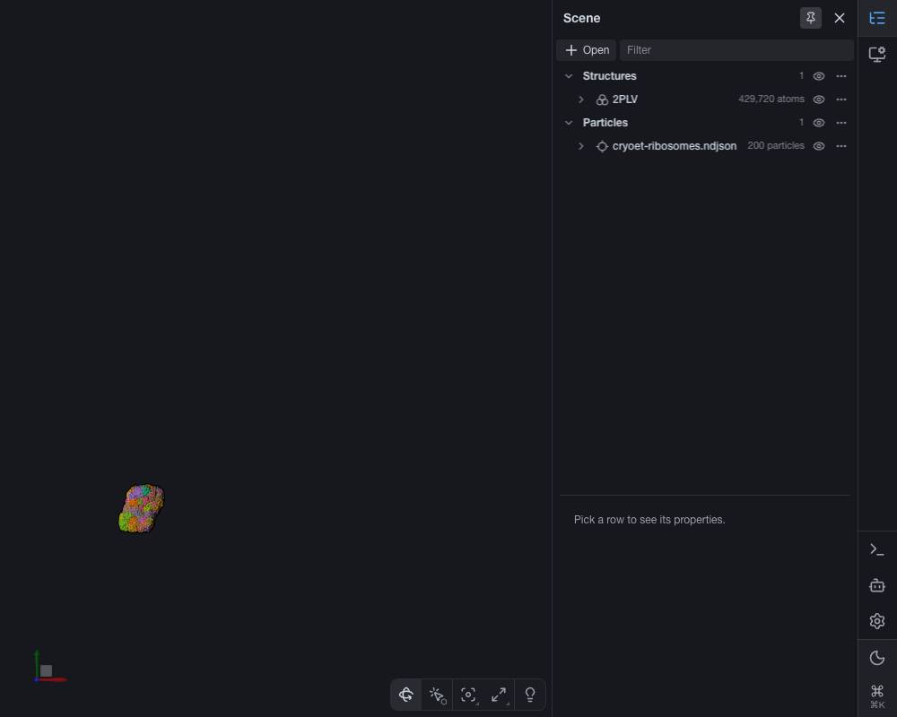     |      |
| WebGPU, zoom 0.3     |   | 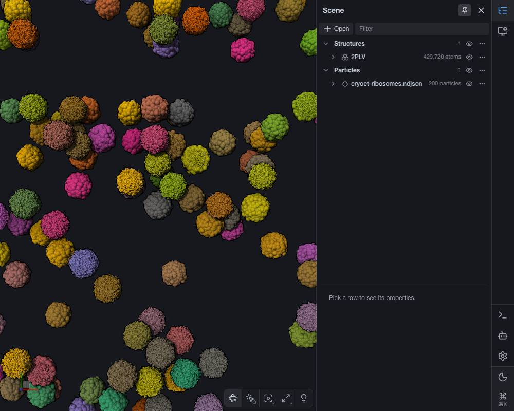  |
| WebGPU, zoom 0.03    | 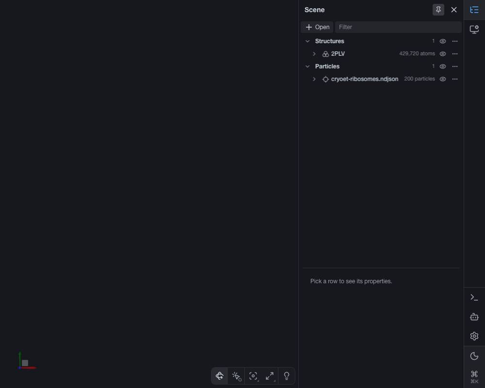 | 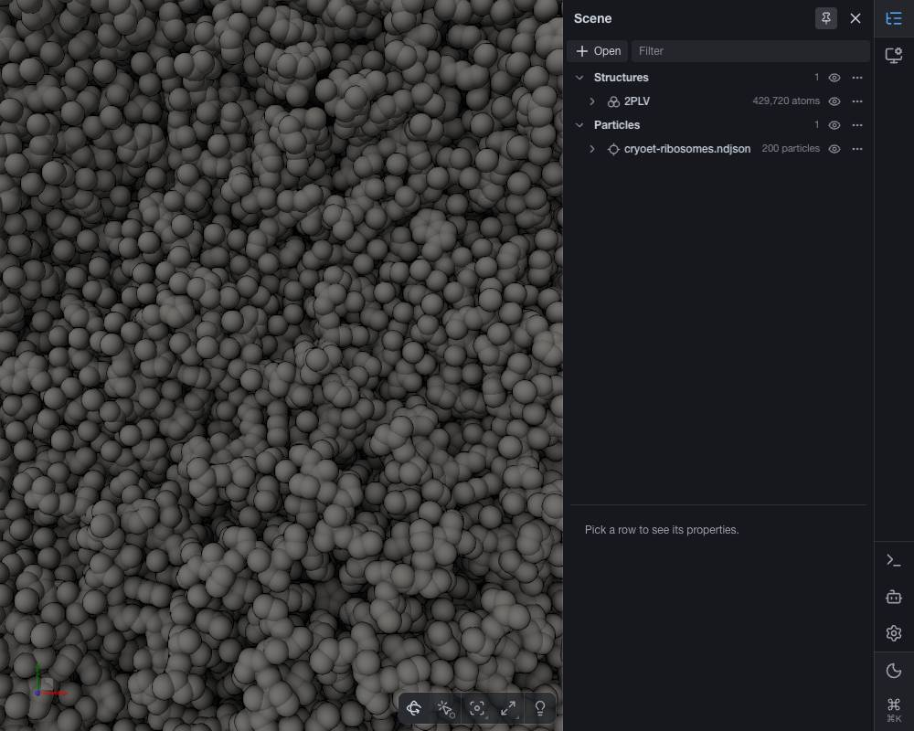 |

| Scale, then decorate | Before (decorate failed)                                                  | After                                                                    |
| -------------------- | ------------------------------------------------------------------------- | ------------------------------------------------------------------------ |
| WebGL2, reset        | 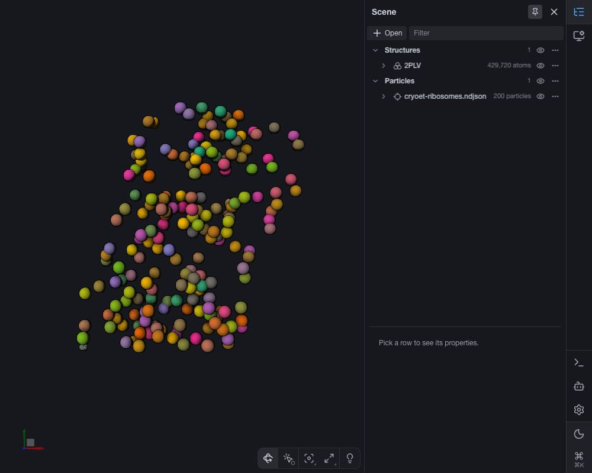    | 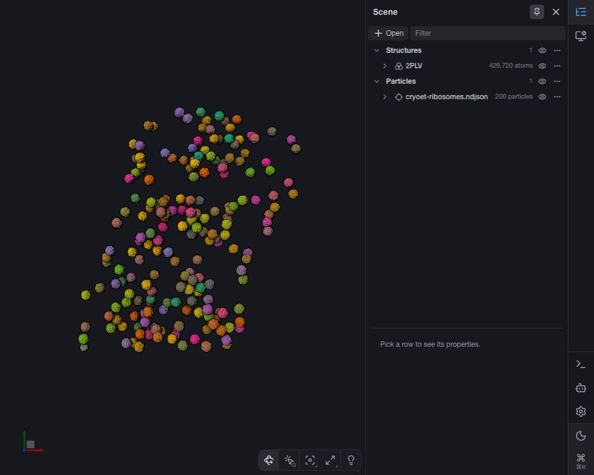    |
| WebGL2, zoom 0.1     |  |  |
| WebGPU, reset        |     |     |
| WebGPU, zoom 0.1     | 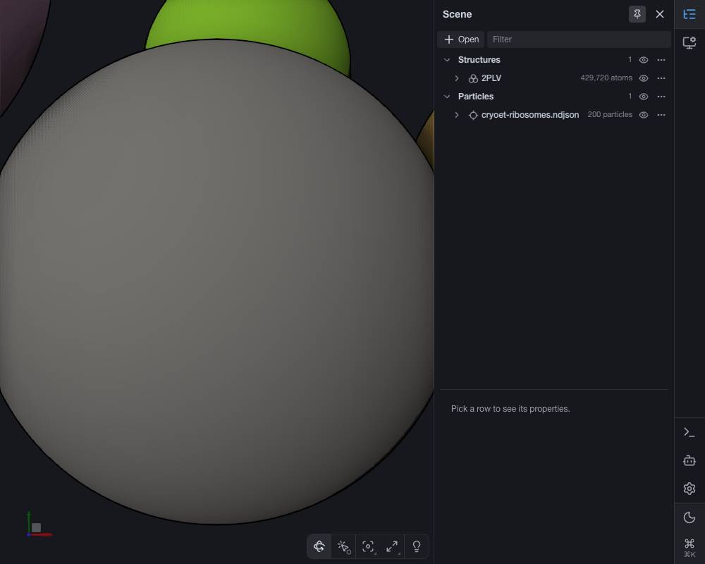 | 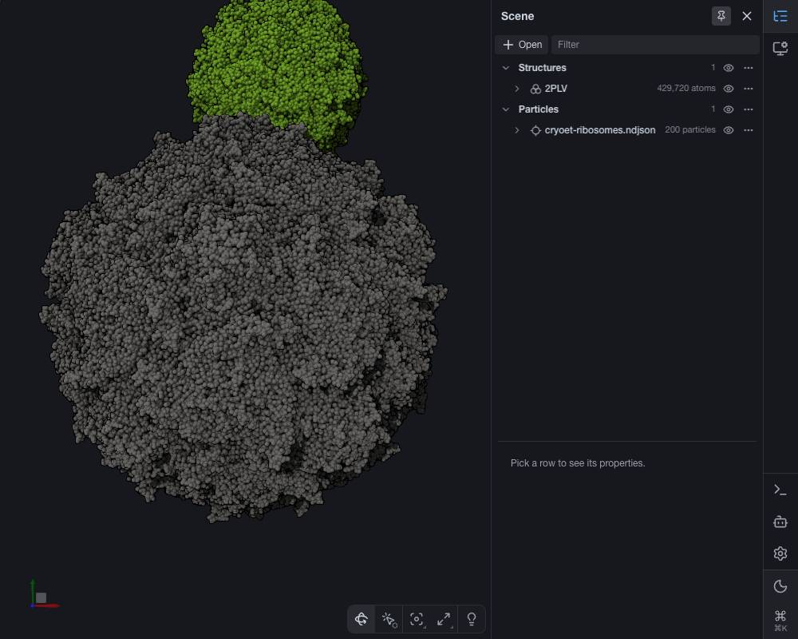 |

| Moved, zoom 0.1 (after) | Scale, then decorate                                                           | Decorate, then scale                                                              |
| ----------------------- | ------------------------------------------------------------------------------ | --------------------------------------------------------------------------------- |
| WebGL2                  |  |  |
| WebGPU                  | 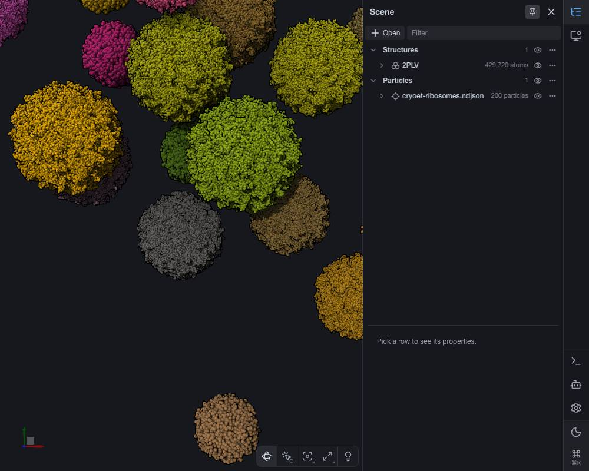 |  |

### Left open

- **A handle's drag preview of a list does not redraw headless** (`stage.previewMove`: `repr.setState({ transform })`
  and `requestDraw`, no `canvas3d.update`). The state moves (the render objects' bounds follow, checked in the app
  test), the drawing stays until the release. The same on a list without decorations, before this lane; with
  `canvas3d.update(repr)` it draws. Not changed here: Ludo to say whether a real drag shows it (pointer events may drive
  the update the headless check lacks).
- **`scaleByRadius` targets' bounds** (shapes scaled by the particle radius): `calculateTransformBoundingSphere` moves
  the center by the scaled matrix but keeps the unscaled radius, at creation as at update (the grid's sphere is inflated
  for it, the render object's is not). Before this lane, upstream too.
- `MergedRenderable` could also sync its merged values when it is made (the invariant at the renderable), not only where
  the representation keeps the object; not done: no GL or WebGPU in this machine's tests to prove it.
- The two graphics fixes go upstream (master lane, then molstar/molstar) when Ludo says so.

### Size

Production: about 60 lines (ops.ts 25, common.ts 7, merged.ts 3, stage-tools 15, changelogs). Tests: about 290 lines
(three files). Over the brief's two bugs: the WebGPU merge race and stage-tools' lookup took the room.
