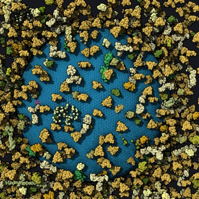
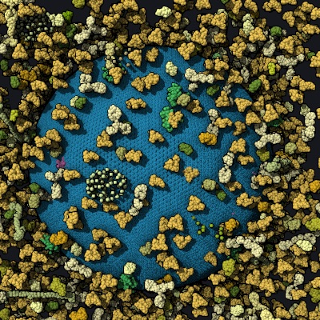
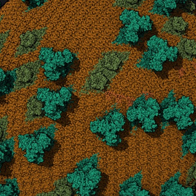

# Close up, only the particles in view (2026-10-31, lane `instance-cull`)

## Brief

- **Asked** (Ludo, 2026-10-31): "even without byzoom for the color, when the camera is close to the atom, framerate drop
  a lot. Loading any mesoscale models cellpack or petworld, zooming in and we can feel the slow down"; "I dont have this
  problem" in cellVIEW. Then "yes" to: per-particle frustum culling first, measured; k-means proxy levels as a design
  note. **Check:** CellPack HIV and PetWorld HIV zoomed close to one capsid protein: the frame time with your change
  against prism-me, on WebGPU (Chrome, Firefox) and WebGL2; no particle missing at the view's edges while turning.
- **What we know** (coordinator, 2026-10-31):
  - Ludo's run of `scripts/zoom-test.js` (Firefox, WebGPU, dpr 2, zoomed): pixel scale 1 / 0.5 / 0.25 the same, LOD
    quality / balanced / performance 300 / 200 / 100 ms (Firefox's WebGPU reports the GPU done every 100 ms: rounded;
    the script now times batches of 20). Headless Chrome, CellPack HIV at 0.05: pixels 40 / 42 / 40 ms, LOD 40 / 27
    / 16. So the cost is the spheres drawn, not the fragments.
  - Mol* culls by 200 Å cells (`gl/compute/cell-cull.ts`, `webgpu/shader/cell-cull.wgsl.ts`; WebGL2 `cullSegment` on the
    CPU): every particle of a cell that touches the view is drawn. `instance-copy` already runs a thread per particle of
    a drawn cell.
  - cellVIEW (`~/Dev/cellpackgpu`, read 2026-10-31): per-instance frustum culling (`ComputeSphereBatches.compute:71`),
    LOD per instance by distance, coarse levels as k-means proxies (15 %, 10 %, 5 % of the atoms, then 12, then a grid;
    `KMeansClustering.compute`, `CellPackLoader.cs:695, 942`), no occlusion culling (commented out), one triangle an
    atom, 100 atoms a batch, one indirect draw.
- **Ludo, 2026-10-31: "dont stop until performance is smooth".** The goal: zoomed in (0.1 and 0.02 of the distance,
  CellPack HIV and PetWorld HIV) at the default `quality`, a frame within 16.7 ms on Chrome WebGPU and within 33 ms on
  WebGL2 on this M1 (the batched `scripts/zoom-test.js` method), with no visible loss against prism-me at rest. Do not
  stop at a step: go through the options in order until the goal holds, each measured before and after, written here:
  (1) per-particle frustum culling; (2) whatever the measurements show next, e.g. coarser while the camera moves and
  full when still, a lower pixel ratio only while moving, the k-means proxy levels (cellVIEW's) built rather than only
  noted, or the LOD defaults; ask only if a step needs Ludo's call on the look (say what changes, with images).
- **Step 1, a measurement before code:** zoomed (1, 0.1, 0.02 of the distance), particles drawn against particles whose
  sphere touches the view, per level, and the frame time (`scripts/zoom-test.js`'s batched method); written here; if the
  gap is small, go to the next option.
- **Step 2, build:** each particle's sphere against the six planes in `instance-copy` (WebGPU), its LOD level kept;
  library commits naming no extension (upstreamable later, with Alexander, when Ludo says so). WebGL2: measured options
  (finer cells near the camera, a CPU test) in this file, built only if small.
- **Step 3, a design note first, then built if the goal still needs it:** k-means proxy spheres per target as the coarse
  levels (cellVIEW's), how they would fit `lodLevels` and the merged objects, their cost at load, for Ludo and
  Alexander.
- **Spec:** `.v6/plans/gl/merged-render-objects.md` (GPU culling), `screen-space-lod.md`; `features.md`.
- **Tests:** a particle outside the frustum in a drawn cell is not drawn, one inside is, at its level; the images
  identical to prism-me's (no particle lost at the edges); a scaling guard on the cull pass.
- **Touches:** `graphics` (cell-cull, instance-copy, merged-culler), the bench script; **stays off:** color levels (PR
  #27, this branch's base: it carries the WebGPU draw-list fix PetWorld needs; merge #27 before this PR).
- **Size:** per step written here before building; no stop on size (Ludo's goal), but say each step's size.
- **Steps and models:** 1. measure (Sonnet) 2. design (Opus) 3. build (Opus) 4. checks (Sonnet) 5. browser on WebGPU and
  WebGL2 (Sonnet) 6. gate (Opus) 7. the proxy note (Opus).

## Step 1: measured before code

`apps/prism-me/scripts/zoom-bench.mjs` (new): headless Chrome (Playwright, Metal), 1280x800 window (canvas 896x800), the
camera moved to 1, 0.1 and 0.02 of its distance to the target (the virion's center: at 0.1 inside the envelope, at 0.02
inside the capsid, the view filled by a few near particles), default `quality`; the frame time by `zoom-test.js`'s
batched method (`T()`, 7 batches of 20), the instances (particles) and spheres per level counted on the CPU from the
members: in a cell drawn at a level (what the cell culling draws; before the per-cell occlusion test) against those
whose own sphere touches the view and the level's distance range. Load average 4 to 6 (other lanes running).

| model, backend       | fraction | frame (ms) | level-0 instances, cell / own | level-0 spheres (M), cell / own |
| -------------------- | -------- | ---------- | ----------------------------- | ------------------------------- |
| CellPack HIV, WebGPU | 1        | 8.9        | 0 / 0 (all at level 2)        | 0 / 0 (0.45 M at level 2)       |
| CellPack HIV, WebGPU | 0.1      | 83.1       | 64,993 / 36,111               | 10.74 / 7.08                    |
| CellPack HIV, WebGPU | 0.02     | 70.5       | 31,561 / 15,725               | 4.81 / 3.25                     |
| CellPack HIV, WebGL2 | 1        | 9.6        | same counts                   |                                 |
| CellPack HIV, WebGL2 | 0.1      | 88.0       |                               |                                 |
| CellPack HIV, WebGL2 | 0.02     | 70.3       |                               |                                 |
| PetWorld HIV, WebGPU | 1        | 26.0       | 0 / 0 (levels 1, 2)           | 0 / 0 (2.74 M / 2.54 at lvl 1)  |
| PetWorld HIV, WebGPU | 0.1      | 119.2      | 7,065 / 3,216                 | 13.10 / 8.40                    |
| PetWorld HIV, WebGPU | 0.02     | 93.6       | 5,013 / 1,804                 | 9.11 / 5.59                     |
| PetWorld HIV, WebGL2 | 1        | 30.4       | same counts                   |                                 |
| PetWorld HIV, WebGL2 | 0.1      | 129.6      |                               |                                 |
| PetWorld HIV, WebGL2 | 0.02     | 101.3      |                               |                                 |

- **Per-particle frustum culling alone saves a third** of the level-0 spheres (CellPack 34 % and 32 %, PetWorld 36 % and
  39 %): linear in spheres, 83 to about 55 ms, short of 16.7 by 3x. The rest of what is drawn is in view but hidden: at
  0.1 and 0.02 a few near particles fill the screen, millions of spheres behind them.
- **The fragments count as much as the spheres close up.** `zoom-test.js` set the pixel scale on Canvas3D, which has
  none (`c.props.pixelScale` undefined): the sweep changed nothing, so "pixel scale 1 / 0.5 / 0.25 the same" (Ludo's
  run, and the brief) measured one resolution three times. Fixed (the context's `setProps({ pixelScale })`, then
  `handleResize`). With it (CellPack HIV, WebGPU, dpr 1), pixel scale 1 / 0.5 / 0.25: 0.1 at 73 / 46 / 37 ms, 0.02 at 62
  / 29 / 22 ms. At dpr 2 (Ludo's display, `--dpr 2`, canvas 1792x1600): 1 at 11.9 ms, 0.1 at 168 ms, 0.02 at 184 ms.
  Close up the impostors overdraw: large quads, a ray per fragment, depth written by the shader (no early depth test).
- **So the step that can reach the goal tests occlusion per particle**, not only the frustum: hidden particles cost
  neither vertices nor fragments. Step 2 builds both in `instance-copy` (below).

## Step 2: per-particle culling on the GPU, measured

Built (WebGPU): `instance-copy` tests each instance of a drawn cell by its own sphere (frustum, distance ranges, each of
the cell's levels, the depth pyramid); the GPU occlusion test clamps a rectangle to the view (one reaching past it was
never occluded) and reads a level finer (up to 4 x 4 texels); `gpuCulling: 'auto'` also from 10 M vertices at full
detail and 30 instances (PetWorld's 19 objects of few large proteins stayed on the CPU's cells). Frame (ms), headless
Chrome, `zoom-bench.mjs`, before / after:

| model, backend, dpr     | 1           | 0.1           | 0.02         |
| ----------------------- | ----------- | ------------- | ------------ |
| CellPack HIV, WebGPU, 1 | 8.9 / 6.0   | 83.1 / 65.2   | 70.5 / 31.4  |
| CellPack HIV, WebGPU, 2 | 11.9 / 10.5 | 167.5 / 146.1 | 183.9 / 76.9 |
| PetWorld HIV, WebGPU, 1 | 26.0 / 23.3 | 119.2 / 75.1  | 93.6 / 65.5  |
| PetWorld HIV, WebGPU, 2 | 45.6 / –    | 324.1 / –     | 271.1 / –    |
| CellPack HIV, WebGL2, 2 | 15.1        | 191           | 199.6        |
| PetWorld HIV, WebGL2, 2 | 49.6        | 341.9         | 284.8        |

(PetWorld at dpr 2 "before" was measured with the step-2 code on, before the auto rule: its objects were still on the
CPU then, so it is the baseline.) Instances drawn (read back from the counters, CellPack HIV): 1 176k to 155k of 229k,
0.1 47k to 48k, 0.02 13.5k to 10k (the frustum-only counts at 0.1: 46k).

- (Corrected in step 2b: the pyramid did occlude; the culler skipped every dispatch after the first against a pyramid
  with holes. The two bullets below are what was believed then.)
- **The depth pyramid barely occludes zoomed in**: a texel keeps the farthest depth it covers, and between the atoms of
  the front particles some pixel of almost every texel shows deep into the model: mesoscale packing is porous at the
  pyramid's resolution. What is seen through a gap must be drawn anyway; the culling draws what is in view.
- **Postprocessing is cheap** (all off: 0.1 from 65 to 62.5 ms); the cost is the spheres: their vertices (pixel scale
  0.25: 0.1 at 34 ms, 0.02 at 15) and their fragments (the rest; at dpr 2 most of the frame).
- **The bound of a coarser look**: `performance` (D 6, pixel scale 0.5) at dpr 2, i.e. native 1x: CellPack 36 / 23 ms,
  PetWorld 50 / 54 ms at 0.1 / 0.02. So at rest, at `quality`, 16.7 ms is out of reach without changing the look; the
  goal's frames are reached while the camera moves (step 3), the rest frame keeps today's look.

## Step 2b: the pyramid of a still view, measured

Found while measuring the switch of the pixel scale: a still view's frames cost 14 ms where the batched method said 65
(CellPack HIV at 0.1). The culler skipped a dispatch while the pyramid's camera was the one it tested last: after a
camera jump the first dispatch tested the pyramid of the old view, the next one the pyramid of a frame drawn from that
(with holes where it culled wrongly), and then never again. Fixed (`OcclusionPyramid.version`: a dispatch per drawn
frame against the newest build; a still canvas draws nothing); what a change at a still view reveals is drawn again (an
object hidden, a level refined). With it the occlusion converges in 3 to 4 frames.

The edges, while turning: a rectangle reaching past the pyramid's view was clamped (my step 2): a particle entering the
view behind another showed a frame late (PetWorld HIV at 0.1, 2° a frame: 15,308 of 716,800 pixels in a frame). Now
clamped only where no part of the sphere beyond the pyramid's frustum is in view (the cap beyond each plane). Not
occluded wherever it reached past, a turning frame cost twice (CellPack 0.1: 22 to 45 ms); with the cap test 37 ms.
`cull-check.mjs` (new): settled images with occlusion against without, and GPU culling against the CPU's cells, at 1,
0.1 and 0.02, both models: no pixel differs. Turning 2° a frame (the frame with occlusion against the same camera
without), the worst frame: at 0.1 13 (CellPack) and 206 (PetWorld) pixels of 716,800; at 0.02 1,397 and 953 (what
parallax uncovers behind a near particle shows a frame late: the one-phase test's limit).

Frame (ms), WebGPU, still / turning 1° a frame (`zoom-test.js` `M()`):

| model, dpr      | 1           | 0.1         | 0.02        |
| --------------- | ----------- | ----------- | ----------- |
| CellPack HIV, 1 | 6.4 / 6.6   | 12.1 / 36.8 | 14.1 / 24.7 |
| CellPack HIV, 2 | 10.8 / 10.8 | 35.4 / –    | 39.1 / –    |
| PetWorld HIV, 1 | 23.3 / 23.4 | 22.0 / 51.1 | 50.3 / 53.5 |
| PetWorld HIV, 2 | 41.2 / 41.0 | 66.4 / –    | 147.9 / –   |

WebGL2 unchanged (CPU culling): CellPack dpr 1 88 / 70 ms, dpr 2 191 / 200 ms; PetWorld dpr 1 129 / 102, dpr 2 342
/ 285.

## Step 3: coarser while the camera moves (built, the first part)

`Canvas3D` `motion` (`lodScale`, `holdMs` 250): while the camera changed within the hold, levels by size on screen drawn
`lodScale` times coarser (`Renderer.setLodScale`, `LodView`'s scale: as at a resolution that many times lower), then one
frame at full detail without a request. Found on the way: a draw list's recording held the view's planes alone, so a
scale (or a resolution) at the same camera replayed the old levels (fixed: the view's Å per pixel with the planes).
Turning frames (ms, WebGPU, before the cap test; still frames unchanged):

| model, dpr      | 0.1, m 2 / m 4 | 0.02, m 2 / m 4 |
| --------------- | -------------- | --------------- |
| CellPack HIV, 1 | 31.5 / 21.0    | 23.2 / 16.6     |
| CellPack HIV, 2 | 83.3 / 61.7    | 63.3 / 47.9     |
| PetWorld HIV, 1 | 48.6 / 31.9    | 52.2 / 40.0     |
| PetWorld HIV, 2 | 130.2 / 97.4   | 153.3 / 131.3   |

At dpr 2 the fragments bound the frame: the levels alone don't reach 16.7 ms; next, the pixel scale while moving.

## Design note: clusters inside a particle, and k-means proxies (for Ludo and Alexander)

What is left once particles are culled one by one: a particle partly in view, or partly behind another, draws all its
spheres. PetWorld's proteins have thousands of atoms each: at 0.02 of the distance a few proteins fill the view (still
50 ms at dpr 1, 148 at dpr 2), most of their atoms out of view or behind their own front. cellVIEW never culls inside a
protein either; it keeps the near ones cheap by its proxy levels.

- **Clusters (state of the art: Nanite's clusters, meshlet culling)**: per target, its atoms split into clusters of 64
  to 128 spheres (k-means on the positions, as cellVIEW's `KMeansClustering.compute`), each with a bounding sphere, the
  atoms of a cluster consecutive in the geometry. The instance test (`instance-copy`) then emits per drawn instance its
  clusters, tested against the frustum and the pyramid as the instances are (a second compaction: instance × cluster,
  the draw an indirect record per level and member, vertices from the cluster's range). Expected: a protein at the
  view's edge or behind its neighbors draws only its clusters in view; close up the spheres drawn would drop by the
  share of each near protein out of view (the counters show it per level). Cost at load: k-means per target (cellVIEW
  runs it on the GPU); memory a sphere and a range per cluster.
- **k-means proxies as the coarse levels (cellVIEW's)**: the cluster centers are the proxy spheres of a level (15 %, 10
  %, 5 % of the atoms, then 12, then a grid), radius from the cluster's extent, in place of `lodLevels`' strides (every
  n-th atom, grown by `stride^(1 / scaleBias)`). Proxies follow the shape: a coarse level could start nearer at the same
  look, which is what makes a still frame cheaper; it changes the look at rest (Ludo's call, with images before and
  after at 1, 0.1 and 0.02). Fits `lodLevels` as levels whose spheres come from another buffer per level (the merged
  object's vertices per level and member, as now; the level's count is the proxy count).
- **Two-phase occlusion** (the exact one, Nanite and niagara): draw what was visible last frame, build the pyramid of
  this frame, test the rest against it and draw what shows; removes the frame of popping parallax uncovers (step 2b: at
  0.02 up to 1,397 pixels in a frame while turning 2° a frame). Splits the opaque pass and builds the pyramid within the
  frame; not built here.

## Step 4: half the resolution while moving (dynamic resolution), measured

`Canvas3D` `motion.pixelScale` (prism-me: 0.5): while the camera moves the context resizes the canvas and the input to
that scale of the resolution (`Canvas3DContext.setMotionPixelScale`, through the plugin's resize), full at rest. Motion
is a change of the view (and of the vertical projection), not of the viewport: the resize back is no motion. The
trackball compares page coordinates with the viewport at full resolution (`setResolutionScale`): a drag moves the camera
as at full resolution, also across the switch within the drag (before: a jump of 89 Å in the test's drag). Turning
frames, WebGPU (ms, before / after; still frames unchanged):

| model, dpr      | 0.1         | 0.02        |
| --------------- | ----------- | ----------- |
| CellPack HIV, 1 | 20.1 / 8.3  | 15.8 / 6.5  |
| CellPack HIV, 2 | 59.0 / 20.1 | 45.5 / 15.9 |
| PetWorld HIV, 1 | 30.6 / 12.6 | 39.4 / 15.1 |
| PetWorld HIV, 2 | 94.2 / 30.6 | 130 / 39.6  |

`cull-check.mjs` at dpr 2: at rest after turning, motion off and on, no pixel differs (the image at rest is the full
resolution's); the turning comparison now with motion off (its frames at full resolution).

## Step 5a: space order within the levels (for clusters)

`setPositionGroup` writes each level's items in Morton order (a level draws the same items): consecutive ranges are
compact in space, what clusters need. Images at 1, 0.1 and 0.02 (both models, dpr 1) against the commit before: 1 pixel
of 1,024,000 differs (ties at equal depth). Its commit message's speedup is wrong: `T()` timed frames still in the
motion hold (coarser, half the resolution) when run with few batches; fixed in `zoom-test.js` (`T` waits past the hold),
and the order alone changes nothing measurable (CellPack 0.1 12.1 ms, PetWorld 0.02 49.4 ms still).

## Step 5b: clusters inside a particle (meshlet culling), measured

Measured first (on this M1): 10,000 indirect draws replay in 1.1 ms (`draw-overhead/*indirect*-bundle`); clusters of 128
/ 256 / 512 / 1024 spheres: PetWorld HIV 4,321 / 2,167 / 1,086 / 547 records, 34 / 17 / 8 / 5 MB; level-0 spheres in
view at 0.02 by the frustum alone 5.59 M by particles, 3.10 / 3.36 / 3.60 / 3.82 M by clusters (2.27 M by atom).
Chosen 256. Built: level 0 of members of 512 spheres or more drawn by a record per cluster, each cluster culled per
drawn instance (`cluster-copy`, indirect workgroups from `cluster-dispatch`: a first version dispatched every (cluster,
instance) pair and cost CellPack's whole view 6.3 to 8.5 ms). Still frames (ms, WebGPU, before / after):

| model, dpr      | 1           | 0.1         | 0.02          |
| --------------- | ----------- | ----------- | ------------- |
| CellPack HIV, 1 | 6.3 / 6.5   | 12.2 / 10.2 | 14.0 / 12.2   |
| CellPack HIV, 2 | 10.8 / 11.0 | 35.5 / 28.3 | 39.2 / 33.6   |
| PetWorld HIV, 1 | 23.1 / 23.3 | 21.9 / 21.1 | 49.4 / 40.5   |
| PetWorld HIV, 2 | 40.3 / 40.7 | 66.4 / 62.8 | 147.4 / 127.1 |

Images at 1, 0.1 and 0.02 (dpr 1) against the commit before the space order: 1 pixel differs (ties). `cull-check.mjs`:
settled, at rest after turning, and the resolution switches, no pixel differs.

## Step 5c: no occlusion while moving (in place of two-phase occlusion), measured

Measured first: turning frames (coarser, at half the resolution) cost about the same without the pyramid (CellPack 0.1
7.8 / 9.0, PetWorld 0.02 14.7 / 15.1 ms at dpr 1). So with `motion` the canvas draws moving frames and the frame it
rests in without occlusion; the next frame tests a pyramid of its own view. `cull-check.mjs --motion` while turning: no
pixel differs from the same frames without occlusion (before: up to 1,397). Decided over two-phase occlusion (a pyramid
within the frame, the opaque pass split): exact for the app at no measurable cost; frames without `motion` (the
library's default) keep the one-phase test's frame of popping.

## Step 5d: WebGL2, measured and built

Hi-Z's CPU test (per cell, a task per frame so its reads land): CellPack 0.1 95 / 89 ms, PetWorld 0.1 134 / 129: about
5%. Built: the CPU culling of objects with levels tests the instances of a cut cell one by one (`cullInstances`; found
on the way: the draw lists' arrays were sized by cells, the draws past them lost; they grow now). With it (Hi-Z's CPU
test off / on): CellPack 0.1 80 / 60, 0.02 50 / 42; PetWorld 0.1 82 / 65, 0.02 78 / 76 ms. Hi-Z's CPU test stays off by
default (its reads lag frames; at rest no frame follows to use them). GPU-driven culling on WebGL2 (transform feedback,
its counts read back frames late) not built: the state of the art for it is compute (WebGPU).

## Step 5e: the wiggle and tumble allowance; 7qpd

Cells and instances grow by √3 times the wiggle's and tumble's amplitudes (`uAnimationSlack`): an animated particle at
the view's edge is kept (test: 4 of 16 instances drawn before). 7qpd's 60-copy assembly: 11.5 k atoms, 60 copies, 4.1 M
indices: under the auto rule's 10 M, it stays on the CPU.

## Step 5f: the look's motion on a 2x display

On a display of 2 device pixels a CSS pixel the look moves at 0.35 of the resolution (about 0.7 of a CSS pixel) and 6x
coarser (else 0.5 and 4x). The first frame of a turn at dpr 2 differs from the next at the same camera by its ambient
occlusion (77,650 of 2.87 M pixels, a frame; images alike).

## Where it stands (round 2)

Frame (ms), headless Chrome on the M1, still / turning 1° a frame (`zoom-bench.mjs`, prism-me's look; before the lane in
brackets, still):

| backend, model, dpr     | 1                 | 0.1                 | 0.02                |
| ----------------------- | ----------------- | ------------------- | ------------------- |
| WebGPU, CellPack HIV, 1 | 6.5 / 7.4 (8.9)   | 10.3 / 9.2 (83.1)   | 12.2 / 7.2 (70.5)   |
| WebGPU, CellPack HIV, 2 | 11.0 / 6.6 (11.9) | 28.3 / 11.5 (167.5) | 33.6 / 8.7 (183.9)  |
| WebGPU, PetWorld HIV, 1 | 23.3 / 4.0 (26.0) | 21.0 / 12.9 (119.2) | 40.5 / 15.2 (93.6)  |
| WebGPU, PetWorld HIV, 2 | 40.7 / 5.9 (45.6) | 62.8 / 15.1 (324.1) | 127.1 / 19.7 (271)  |
| WebGL2, CellPack HIV, 1 | 9.2 / 7.3 (9.6)   | 72.0 / 13.7 (88.0)  | 39.5 / 10.9 (70.3)  |
| WebGL2, CellPack HIV, 2 | 13.8 / 7.3 (15.1) | 155.1 / 17.4 (191)  | 91.4 / 12.7 (199.6) |
| WebGL2, PetWorld HIV, 1 | 30.8 / 6.1 (30.4) | 75.1 / 18.1 (129.6) | 71.4 / 20.7 (101.3) |
| WebGL2, PetWorld HIV, 2 | 49.1 / 7.5 (49.6) | 166.2 / 22.1 (342)  | 190.1 / 26.4 (285)  |

Turning meets the goal (16.7 ms WebGPU, 33 ms WebGL2) everywhere but PetWorld HIV at 0.02 on WebGPU at dpr 2 (19.7).
Still frames meet it on WebGPU at dpr 1 for CellPack; at rest the full-quality frame of PetWorld close up, of dpr 2 and
of WebGL2 stays above (one frame; hover and other redraws at rest pay it). What would lower it changes the look at rest:
the k-means proxy levels (Ludo's call, below).

## Round 3 (Ludo, 2026-10-31: no proxies, no coarser detail while moving, keep the lower resolution)

1. The look: `motion.lodScale` 1 (full detail always), `pixelScale` 0.5 (0.35 on 2x). Turning at full detail, without
   occlusion while moving (round 2's choice for coarse frames): CellPack 0.1 41 / 48 ms (dpr 1 / 2), PetWorld 0.1 47 /
   54; with one-phase occlusion while moving: 20 / 24, 25 / 39 (and its frame of popping).
2. Two-phase occlusion (state of the art: Nanite, niagara), built: exact while moving. The first phase draws what was
   visible last frame (per instance a bit, per cluster and instance a bit), the draw pass builds this frame's pyramid of
   that depth, the second phase draws what it shows. Found on the way: the clusters' bits were indexed by the merged
   `aInstance` (global, not the member's), and the pyramid's passes left their viewport for the second phase's.
   `cull-check.mjs`, both models, 0.1 and 0.02: settled, turning, at rest after turning and the resolution switches, no
   pixel differs.
3. Where a full-detail turning frame spends (dpr 2, WebGPU, CellPack 0.1 / PetWorld 0.02, 17.9 / 24.9 ms): the
   post-processing 2 to 3 ms (all off 15.5 / 23.5), SSAO and shadows 2 ms, the resolution most of the rest (at 0.2 of
   the resolution 10.9 / 15.9 ms); PetWorld close up stays vertex-bound (its near proteins' atoms).

Frame (ms), still / turning 1° a frame, full detail; round 2 (coarser while moving) in brackets, turning:

| backend, model, dpr     | 1                 | 0.1                 | 0.02                |
| ----------------------- | ----------------- | ------------------- | ------------------- |
| WebGPU, CellPack HIV, 1 | 8.4 / 8.4 (7.4)   | 11.1 / 12.5 (9.2)   | 13.2 / 6.9 (7.2)    |
| WebGPU, CellPack HIV, 2 | 13.1 / 7.9 (6.6)  | 30.4 / 17.9 (11.5)  | 36.0 / 11.3 (8.7)   |
| WebGPU, PetWorld HIV, 1 | 27.0 / 19.8 (4.0) | 22.5 / 15.8 (12.9)  | 45.2 / 17.6 (15.2)  |
| WebGPU, PetWorld HIV, 2 | 47.5 / 23.4 (5.9) | 68.4 / 18.9 (15.1)  | 136.4 / 24.9 (19.7) |
| WebGL2, CellPack HIV, 1 | 9.8 / 9.2 (7.3)   | 75.1 / 50.6 (13.7)  | 41.2 / 30.0 (10.9)  |
| WebGL2, CellPack HIV, 2 | 16.4 / 9.7 (7.3)  | 159.0 / 61.2 (17.4) | 96.8 / 36.4 (12.6)  |
| WebGL2, PetWorld HIV, 1 | 34.1 / 25.9 (6.1) | 85.5 / 52.4 (18.1)  | 74.7 / 39.7 (20.7)  |
| WebGL2, PetWorld HIV, 2 | 52.7 / 31.0 (7.7) | 188.3 / 66.0 (22.6) | 195.6 / 53.2 (27.2) |

Met (≤16.7 WebGPU, ≤33 WebGL2): WebGPU turning at dpr 1 (but PetWorld 0.02, 17.6, and whole views of PetWorld), CellPack
0.02 turning at dpr 2; still frames only CellPack at dpr 1. Not met: WebGL2 close up (CPU culling, no occlusion while
moving: its Hi-Z test's reads lag frames), PetWorld at dpr 2, still frames at dpr 2. What is left without changing the
look: per-sphere occlusion in the vertex stage of the second phase (atoms behind their own protein's front), a cheaper
impostor (its depth written by the fragment stage defeats early depth tests and the M1's hidden-surface removal; WebGPU
has no conservative depth), GPU-driven culling on WebGL2 (none fits without compute).

## k-means proxy levels (dropped: Ludo, 2026-10-31)

Where the still frame stays slow (PetWorld HIV close up, dpr 2, WebGL2) the remaining lever is a cheaper look at rest:
coarse levels from k-means proxies (cellVIEW's) in place of every n-th atom, so that a coarse level can start nearer at
the same look. A preview (`apps/prism-me/scripts/proxy-preview.mjs`: in the page the spheres a coarse level draws
replaced by the k-means centers of all the target's atoms, k its count, 6 Lloyd steps; same radius and scale), whole
view, the camera after the load (canvas crop 400 x 400):

| model, level | every n-th atom (now)                                        | k-means proxies                                              |
| ------------ | ------------------------------------------------------------ | ------------------------------------------------------------ |
| CellPack, 2  |  |  |
| PetWorld, 1  |  |  |

15% (CellPack) and 23% (PetWorld) of the pixels differ. The proxies keep each protein's shape a little more compact
(CellPack's capsid, its matrix proteins); PetWorld's membrane shows the clusters' pattern as streaks. Not built: the
levels would no longer nest (a level draws a prefix of the spheres now), so each level's own range, its first index in
the records and cells, and the k-means at load (on the GPU in cellVIEW). Ludo: keep every n-th atom, or build the
proxies (and then: their radius from each cluster's extent, as cellVIEW)?

## Built

- `instance-copy` tests each instance by its own sphere (view, ranges, levels, pyramid); the occlusion test a level
  finer, clamped at the edges with the cap test after a turn; a dispatch per pyramid build (`OcclusionPyramid.version`),
  `gpuCullUnsettledCount` and the frames that settle a view at rest; `gpuCulling: 'auto'` from 10 M vertices.
- `Canvas3D` `motion`, `Renderer.setLodScale`, `LodView.set`'s scale; the draw lists' view with its scales.
- prism-me's look sets `motion` 4x; `zoom-bench.mjs`, `cull-check.mjs`; `zoom-test.js` fixed (pixel scale) and `M()`.

## Decided

- Per-instance frustum, levels and occlusion in the copy's thread (GPU-driven culling as Nanite's instance pass and
  niagara): the thread ran anyway; the spec's dropped variant read instances per vertex.
- One-phase occlusion against the previous frame's pyramid, made exact at rest (frames forced until a pyramid of the
  view was tested) and conservative at the view's edges (the cap test); two-phase (exact while moving) left open.
- Coarser while moving, full at rest (dynamic quality as in Potree, Cesium, game engines' dynamic resolution): the rest
  frame keeps prism-me's look; the trigger is the camera changing with a 250 ms hold (a wheel zooms in steps). 4x: the
  smallest scale that brought CellPack's turning frame near 16 ms at dpr 1 (2x: 31 ms).
- `gpuCulling: 'auto'` on from 10 M vertices: PetWorld's 19 objects of few large proteins were on the CPU.
- Library default of `motion` off (upstreamable without a change of look); the app sets it.

## Learned

- The skip of a still dispatch was the cost close up, not porous packing: tested once against a pyramid with holes, it
  never tested again (65 ms to 12 at 0.1).
- `zoom-test.js`'s pixel-scale sweep changed nothing (Canvas3D has no pixel scale): close up the fragments are half the
  frame at dpr 1, most of it at dpr 2.
- Recorded draw lists keyed the view by its planes: any level-of-detail change at the same camera (a resize too)
  replayed old levels.

## Size

About 400 production lines (graphics: the WGSL tests and edges, the culler's settle and planes, Canvas3D `motion`, the
renderer's scale and counts) and 600 of tests and scripts; no size given in the brief.

## Review

Reviewer (Opus): 4 must-fix, 3 should-fix, 5 nits; skeptic: 4 confirmed, 1 confirmed narrower, 3 plausible, 1 refuted, 2
new. Fixed: the scaling guard (`mesoscale/_test/merged-culler.scaling.ts`), the spec lines left from before (per cell
and per instance, a level finer), `zoom-test.js`'s header, the level-of-detail scale reset on every exit of a render (a
highlight redrawn alone returned before; no test: an image pass in the headless harness showed nothing), the pyramid
versions never reset, the auto rule's count said to be indices, the comment on picks. Refuted: XR staying coarse. Open
(TODO.md): wiggle and tumble slack, a canvas forcing frames while no pyramid lands, Firefox, 7qpd under the auto rule;
the goal itself (pixel scale while moving, clusters and proxies, two-phase occlusion, WebGL2).

Round 2 (`2158a99a9..`): reviewer (Opus) 1 must-fix, 10 should-fix, 5 nits; skeptic: confirmed M1, S3, S4, S7, S8, S10,
S9 (the CPU Hi-Z test while moving), S6; plausible S1 (the dispatch's rows), S2, S5; refuted S1's "all segments" (cost
only) and S9's docs; 3 new (N1 the object's distance range per instance on the CPU, N2 images in the hold at coarse
levels, N3 the display density read once). Fixed: the kernels' header; clusters only within a dispatch's rows and a
binding's size, their workgroups by clustered segments; the CPU allowance for wiggle and tumble and occlusion with the
largest sphere (test first); no motion switch where nothing resizes the canvas; an image pass ends a motion (N2 too); no
CPU occlusion while moving; the projection compared within a tolerance; the cluster test with a segment before the
clustered one; spec, changelog, a stale comment. Open (TODO.md): S7 (the headless context resizes nothing: the resize
back is not tested as no motion), N1, N3, no tests for S5 and S6 (they need a DOM canvas).
