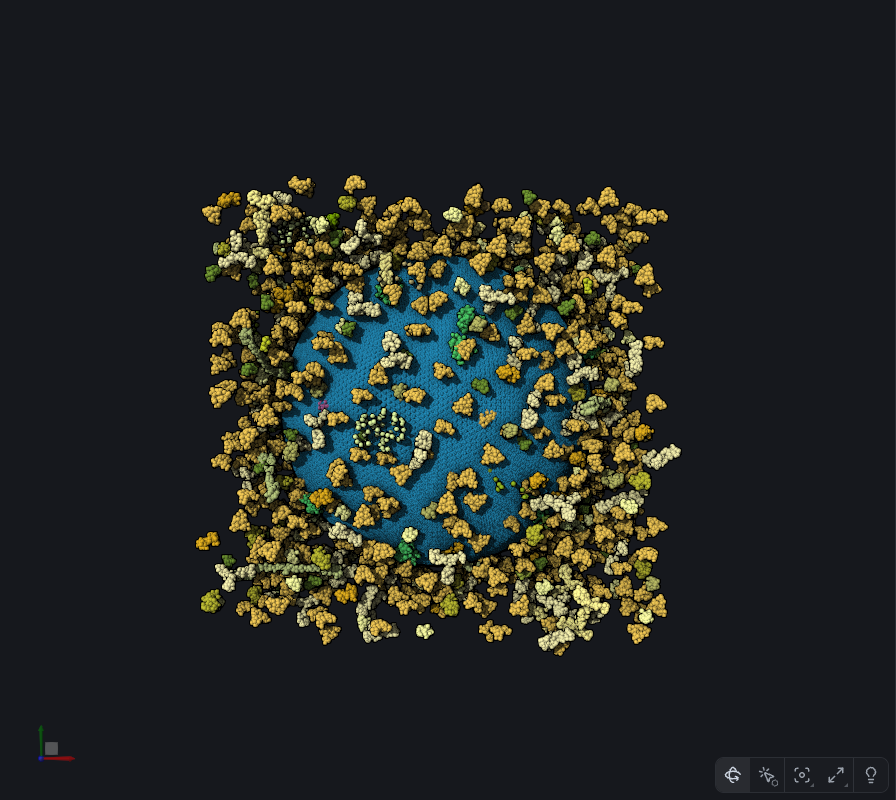
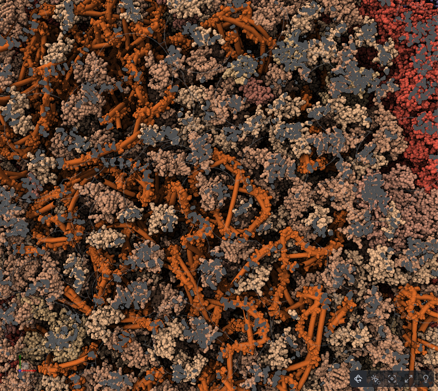
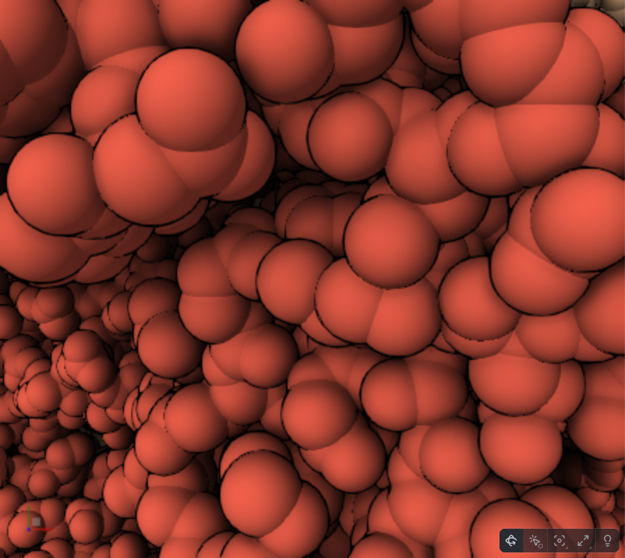

# What marking and transparency cost (lane `marking-cost`)

Branch `me/marking-cost` from `origin/prism-me` (after #31). Worktree `~/prism-me-lanes/marking-cost`. Dev port 1367.

## Why (Ludo, 2026-10-31, from Alexander)

"also you generally want to switch marking off or at least set ghost edge strength to 1 - otherwise you render
everything at least twice... the transparent stuff is not cheap either..."

## What is known (check it)

- prism-me's look (`apps/prism-me/src/look.ts`, `MesoscaleCanvasLook`) has these marking settings:
  - `enabled: true`, `ghostEdgeStrength: 1` (already);
  - `highlightEdgeStrength 1`, `selectEdgeStrength 1`;
  - `innerEdgeFactor 2.5`, `edgeScale 2`.
- The marking pass is `packages/graphics/src/canvas3d/passes/marking.ts`.
  - `depthTest = ghostEdgeStrength < 1 || dim` is around line 397.
  - With marking off, highlight and select are drawn by `colorMarker` in the shaders (around line 67), as a tint, not as
    edges.
- Transparency in prism-me's look:
  - the outline's `transparentColor` for ghosts;
  - clips' ghosts (#24, a depth draw);
  - #17's hidden layers (hidden instances still drawn at transparency 1 until #17 step 1);
  - Look › Shown layers;
  - the `includeTransparent` outline (off).
- Benches:
  - `apps/prism-me/scripts/zoom-bench.mjs` gives still and turning frames at 1 / 0.1 / 0.02, WebGPU and WebGL2, dpr 1
    and 2;
  - `scripts/hidden-cost-bench.mjs`;
  - `scripts/cull-check.mjs`.

## Do

1. **Measure, nothing changed.** On CellPack HIV and PetWorld HIV, WebGPU and WebGL2, dpr 1 and 2, at 1, 0.1 and 0.02 of
   the distance, still and turning, take frame times with:
   - marking as now;
   - marking off;
   - nothing hovered or selected;
   - something hovered;
   - a selection;
   - a clip with Ghosts;
   - a layer shown in part;
   - a Look with transparency.

   Find what is drawn twice:
   - Does the marking pass redraw every object even when nothing is marked?
   - What does each transparent case cost?

   Write the tables in this file.

2. **Changes that keep the image, without asking.**
   - For example, the marking pass draws nothing, or skips objects with no mark, when nothing is hovered or selected.
   - A transparent draw is skipped where the object has no transparent part.
   - Pick by state of the art.
   - Each change gets a test that fails first, plus before/after numbers, and pixel-identical images with
     `cull-check.mjs` or the same method.
3. **Changes that alter the look: images, then stop.** For example:
   - marking off, so hover and select become a tint instead of edges;
   - a cheaper ghost;
   - a different transparency mode.

   Put side-by-side images (now / proposed) and numbers in this file. Stop and report. Ludo decides; do not change the
   look on your own.

4. Say which changes are library changes (upstream candidates, Ludo decides) and which are prism-me's look.

## Rules

- Never rebase; merge. Never push to upstream molstar/molstar.
- Commit messages say "Ludo" and end with `Co-Authored-By: Claude Opus 5.5 <noreply@anthropic.com>`. Push after each
  commit.
- Tests with `--maxWorkers=2`, no parallel suites. Stop your dev server when done.
- Another lane runs at the same time: `startup-budget` on port 1366. Do not use its port or worktree. Ludo's live server
  is 1343: do not use it.
- Do not touch `current.md`.
- Say who did each commit, if anyone but you works on this lane.
- The gate before the PR:
  - `npx tsc -b`;
  - `npx tsc --noEmit -p apps/prism-me`;
  - lint and format:check;
  - `node scripts/workspace/assets.mjs`, then check:workspace;
  - the unit tests of the packages touched;
  - the headless WebGPU suite;
  - test:scaling;
  - styles:check and typecheck:storybook (it fails on prism-me in `packages/prism/viewer/src/api/styles.ts` from #24:
    say so, do not fix it here).

  Then the lane-reviewer, then the lane-skeptic.

- Then `gh pr create -R corredD/molstar-proto --base prism-me` for the changes that keep the image. The PR body ends
  with `🤖 Generated with [Claude Code](https://claude.com/claude-code)`. Do not merge.

## Measured (Grok, 2026-10-31, while Claude was away)

Nothing in the shaders was changed for this pass. `apps/prism-me/scripts/marking-bench.mjs` (Claude wrote it; committed
as `4e5590f0f`) on the dev server at port 1367. CellPack HIV (`inner_membrane`, 114460) and PetWorld HIV (`NC`, 4600).
WebGPU and WebGL2, dpr 1 and 2, fractions 1 / 0.1 / 0.02 of the camera distance. Still and turning are medians of 5
batches of 20 frames. Times are milliseconds.

WebGL2's `calls.draws` stayed 0: the bench sums `drawInstanced` / `drawInstancedBase` / `multiDrawInstancedBase`, which
are the WebGPU indirect counters. WebGL increments `drawCount` / `instanceCount`. The times are the measurement.

Turning is cheaper than still once the view is close, because the look drops `motion.pixelScale` (0.5, or 0.35 at dpr
≥ 2) while the camera moves.

### Does marking redraw everything when nothing is marked?

No. With prism-me's look (`ghostEdgeStrength` 1, `dimStrength` 0) the depth pass is off, and `hasMarking` is false when
`markerAverage` is 0, so the mask is not drawn. Still, fraction 0.1, marking on against marking off:

|               | WebGPU dpr 1 | WebGPU dpr 2 | WebGL2 dpr 1 | WebGL2 dpr 2 |
| ------------- | ------------ | ------------ | ------------ | ------------ |
| CellPack, on  | 12.2         | 29.8         | 74.4         | 162.3        |
| CellPack, off | 11.4         | 33.5         | 77.6         | 162.1        |
| PetWorld, on  | 27.1         | 80.0         | 84.0         | 194.8        |
| PetWorld, off | 27.5         | 81.5         | 86.0         | 195.0        |

The gap is noise, about 1 ms. Alexander's "at least twice" is the other setting: `ghostEdgeStrength` below 1, which
draws a depth pass of the unmarked scene and then the mask. This look does not do that.

### What a mark costs

A hover here marks two objects (`markerAverage` 0.0692 and 0.5 on CellPack, 0.0538 on PetWorld). The mask pass shades
every instance of those objects and discards `marker == 0` in the fragment shader, after the sphere projection. Still,
fraction 0.1, before the change:

|                          | WebGPU dpr 1 | WebGPU dpr 2 | WebGL2 dpr 1 | WebGL2 dpr 2 |
| ------------------------ | ------------ | ------------ | ------------ | ------------ |
| CellPack, nothing marked | 12.2         | 29.8         | 74.4         | 162.3        |
| CellPack, hover          | 16.7         | 42.5         | 101.5        | 213.4        |
| CellPack, select         | 13.8         | 40.4         | 100.2        | 216.2        |
| PetWorld, nothing marked | 27.1         | 80.0         | 84.0         | 194.8        |
| PetWorld, hover          | 38.1         | 93.1         | 86.1         | 200.3        |
| PetWorld, select         | 38.2         | 93.1         | 97.7         | 197.6        |

The mark-change time (hover on and off at rest, the marking pass only) on CellPack at 0.1: WebGPU 21.2 / 29.8 ms (dpr 1
/ 2), WebGL2 31 / 62.9 ms. With marking off, that same change redraws the whole frame: WebGL2 dpr 2 at 0.1 is 170.8 ms.
Marking on is the cheaper way to update a hover.

### Transparency, a partial layer, clip, ghosts

Still, fraction 0.1. "Shown" is the largest entity at shown 0.5 (hidden instances are not drawn). "Transparency" is that
entity at transparency 0.5 (CellPack averages 0.249 and 0.248; PetWorld 0.498 on WebGL2 and 0.143 on WebGPU).

|                            | WebGPU dpr 1 | WebGPU dpr 2 | WebGL2 dpr 1 | WebGL2 dpr 2 |
| -------------------------- | ------------ | ------------ | ------------ | ------------ |
| CellPack, shown 0.5        | 11.4         | 30.9         | 73.7         | 156          |
| CellPack, transparency 0.5 | 14.9         | 41.9         | 111.7        | 251          |
| CellPack, clip             | 45.6         | 113          | 87.7         | 193.3        |
| CellPack, ghosts           | 71.9         | 186.4        | 151.2        | 338.9        |
| PetWorld, shown 0.5        | 30.8         | 71.6         | 82.9         | 204.9        |
| PetWorld, transparency 0.5 | 63.1         | 147.5        | 93.8         | 223.7        |
| PetWorld, clip             | 54.1         | 118.2        | 113.6        | 240.2        |
| PetWorld, ghosts           | 88.9         | 198          | 178.9        | 411          |

Shown in part is free: it does not add a pass. A mixed transparency puts the object in the opaque pass and the
transparent pass; the opaque pass shades the transparent instances and discards them. That is a few milliseconds on
WebGPU dpr 1 and about +37 ms on WebGL2 dpr 1, +89 ms on WebGL2 dpr 2 (CellPack, 0.1). Clip and ghosts dominate, because
the cut reveals the interior occlusion had hidden, and a ghost draws the cut list again. WebGPU draw counts stay 2857:
the cost is fragment work, not more draws.

## What changed (image kept)

`1b1b7fe72`, graphics, an upstream candidate. Sphere impostors only.

- Marking mask (`uMarkingType != 1`): an unmarked instance sets `gl_Position` outside the clip volume and returns before
  `sphereProjection`. The depth pass (`uMarkingType` 1) still draws it, because unmarked spheres occlude. A mesh
  triangle or a bond can carry a different marker on each vertex, so those keep the fragment discard.
- Color and tracing: a sphere the pass would discard whole (opaque pass and `ta < 1`, or transparent pass and `ta == 1`)
  returns the same way. Only when every fragment agrees: `uAlpha == 1`, `uAlphaThickness == 0`, not x-ray, not opaque
  back faces, not a per-vertex transparency. The default sphere look is in this set (`transparentBackfaces` off,
  `alphaThickness` 0).

The test `packages/graphics/src/gl/_test/marking-mask-clip.test.ts` failed first (the clip strings were absent; mesh and
the unsafe variants stay without them) and then passed. Frames of CellPack taken the same way before and after are the
same pixels: the center highlight (WebGL2 exact; WebGPU exact above the toolbar), the half-transparent membrane up close
(WebGPU and WebGL2, 0 differing pixels), and a clip and its ghosts (WebGPU, 0 differing pixels).

### After, CellPack, fraction 0.1, still

The same four cases, remeasured after `1b1b7fe72`. PetWorld was not run again: it uses the same shaders, and its before
table stands. Still milliseconds, before → after. "None" is the unmarked floor on the after run (the machine moved a few
milliseconds between the two runs; compare a row with its own floor).

|                    | WebGPU dpr 1 | WebGPU dpr 2 | WebGL2 dpr 1 | WebGL2 dpr 2  |
| ------------------ | ------------ | ------------ | ------------ | ------------- |
| none               | 12.2 → 11.2  | 29.8 → 30.5  | 74.4 → 74.6  | 162.3 → 168.1 |
| hover              | 16.7 → 11.6  | 42.5 → 31.7  | 101.5 → 84.1 | 213.4 → 171.1 |
| select             | 13.8 → 11.6  | 40.4 → 38.1  | 100.2 → 83.2 | 216.2 → 170.3 |
| transparency 0.5   | 14.9 → 12.0  | 41.9 → 33.2  | 111.7 → 86.7 | 251 → 170.1   |
| hover, mark change | 21.2 → 13.6  | 29.8 → 16.4  | 31 → 15.2    | 62.9 → 15.5   |

Hover and the half-transparent membrane now sit on the unmarked frame on WebGPU at dpr 1, and within a few milliseconds
of it on WebGL2 (hover at dpr 2: +51 ms over an unmarked frame before, +3 ms after; transparency at dpr 2: +89 ms
before, +2 ms after). One row did not: select on WebGPU at dpr 2 stayed at 38.1 against a 30.5 floor, while hover on
that config fell to 31.7. Both mark the same two objects, and the draw count is the same, so that gap is the marked
instances' fragments on that one run, not a path the skip missed. Draw counts did not drop anywhere: the skip is inside
the draw, before the projection, not a draw the CPU never records. Turning follows the same shape and stays cheaper,
because motion still drops `pixelScale`.

Wide view (fraction 1) was already a few milliseconds; the skip takes CellPack hover from 10.7 to 9.3 (WebGPU dpr 1),
16.9 to 14.6 (dpr 2), 11.8 to 11.3 (WebGL2 dpr 1), 18.4 to 16.8 (dpr 2). Close up (0.02), hover: 16.9 → 13.6, 51.6 →
44.9, 51.4 → 44.6, 123.3 → 102.2.

## Look, not changed

Side by side, CellPack, WebGPU, dpr 1. Marking stays on.

The hovered particle at the wide view is a few pixels at the center: 33 pixels of edge with marking on (max channel
delta 232), 17 pixels of tint with marking off (max delta 60). Marking off does not make an idle frame faster, and a
hover update with it off redraws the whole frame, which is slower than the marking pass.

A cheaper ghost would be a different image. Not done. The next image-preserving win is a sphere the plane cuts entirely
(its center is past the plane by more than its radius): skip it in the color pass, and skip one the plane misses
entirely in the ghost pass. A cone or a scaled sphere is not a safe radius test. It needs a rendered pixel test of the
kind in `clip-ghosts-draw.test.ts` before it ships. Left for Ludo to start.

## Who

Claude wrote the brief and the bench. Grok ran the eight measurements, committed the bench (`4e5590f0f`), wrote the
sphere skip and its test (`1b1b7fe72`), remeasured CellPack after the change (`459d33398`), locked the test
(`94ae9dcef`) after the review, and added inverted x-ray (`8782d0952`) after the skeptic.

## The gate

On `459d33398`, from this worktree, `mise exec`:

- `npx tsc -b` and `npx tsc --noEmit -p apps/prism-me` pass.
- `pnpm lint`, `pnpm format:check`, `node scripts/workspace/assets.mjs` (no change) and `pnpm check:workspace` pass.
- `pnpm exec vitest run packages/graphics --maxWorkers=2`: 135 files passed, 10 skipped, 1624 tests passed, 94 skipped.
  The skipped files are the real-GL draws (`spheres.test.ts` and its neighbours) and cases inside files that skip
  without a GL context. `marking-mask-clip.test.ts` is 6 passed.
- Headless WebGPU (`pnpm native:install -- --webgpu`, then
  `pnpm native:run -- pnpm exec vitest run packages/plugin/headless/src/_test/webgpu- --maxWorkers=2`): 31 files, 73
  tests, none skipped.
- The app's `test:scaling`: 2 files, 5 tests. `styles:check` and `typecheck:storybook` pass.
- Prism viewer's `typecheck:storybook` fails in `packages/prism/viewer/src/api/styles.ts:114` (`transparentColor`, from
  #24), as the brief says. Not fixed here.

The commits after that are the test lock, the plan sentence, and inverted x-ray. The test file was run again after each
(6 passed) and `biome check` is clean.

## Review

Lane-reviewer: 0 must-fix, 2 should-fix, 1 nit. Lane-skeptic: 2 confirmed, 1 refuted, 1 new nit. The shaders already had
the rule. The holes were the test.

| Finding                                                                                                                                                                                  | Severity   | Verdict                                                                                                                                                                      | Commit / open |
| ---------------------------------------------------------------------------------------------------------------------------------------------------------------------------------------- | ---------- | ---------------------------------------------------------------------------------------------------------------------------------------------------------------------------- | ------------- |
| The transparency test does not require the 0.09 cutoff, the strength scale, or the transparent-pass compare, so deleting them still passes and a sphere near 0.086 can leave both passes | should-fix | confirmed. The strength hole is the GLSL re-read only; WGSL reads `out.vTransparency`, already scaled                                                                        | `94ae9dcef`   |
| The WGSL case does not cover opaque back faces, a per-vertex transparency, or the marking variant                                                                                        | should-fix | confirmed                                                                                                                                                                    | `94ae9dcef`   |
| `.v6/plans/gl/sphere-impostors.md` still said every sphere vertex computes the projection                                                                                                | nit        | refuted: that paragraph is the pre-change cost snapshot, and a fully opaque sphere still projects. The sentence now also names the exception; the measurements are unchanged | `5ac8652d6`   |
| Inverted x-ray was not in the test. Narrowing the guard to `dXrayShaded_on` would still pass, and an inverted sphere with texture transparency would leave the only pass that draws it   | nit        | confirmed. `on` and `inverted` both keep the clip out                                                                                                                        | `8782d0952`   |

## Built

The image is unchanged. Hover and a half-transparent membrane on CellPack now cost about an unmarked frame (the table
above). Clip and ghosts were not touched. The look was not changed: marking off is not faster, and a hover with it off
redraws the whole frame. The sphere skip is a library change, an upstream candidate (TODO.md); the plane-instance skip
is left open for Ludo. No budget was raised.
