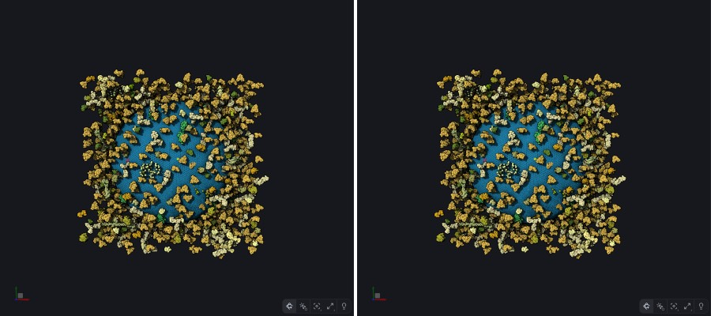
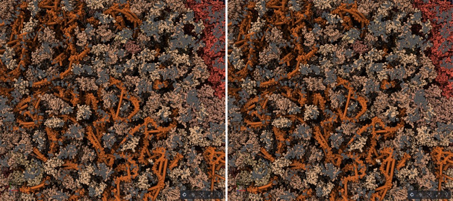
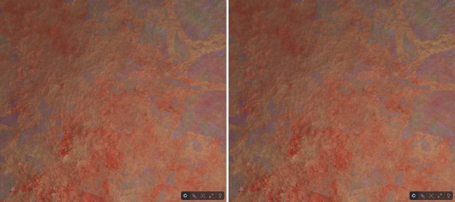
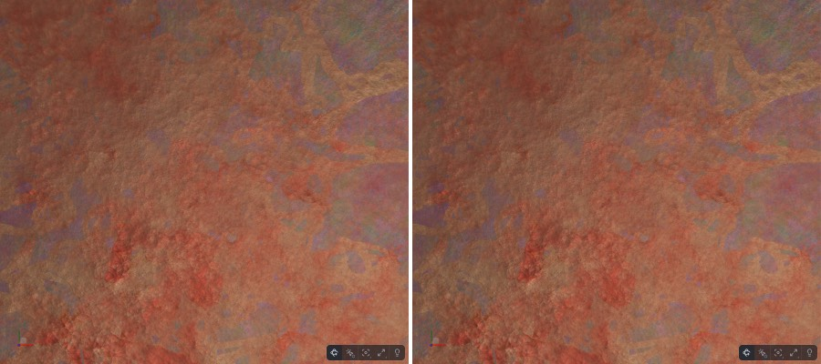
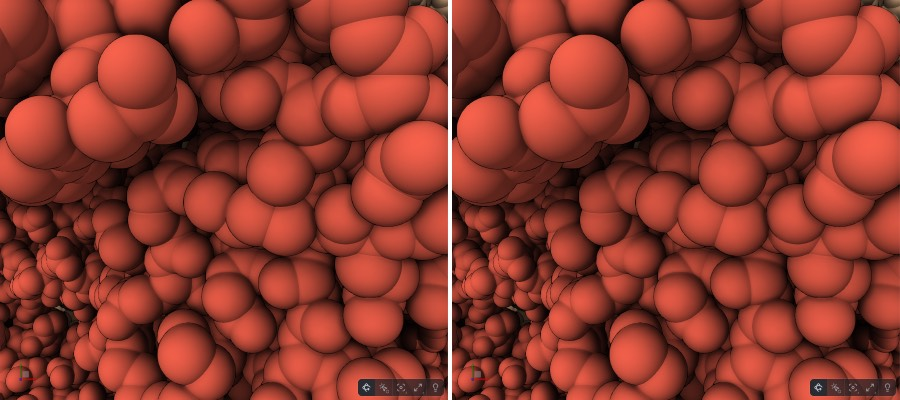
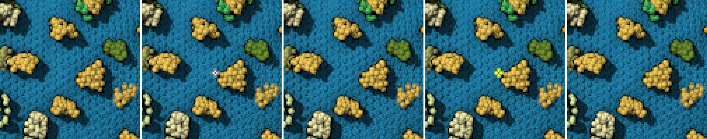
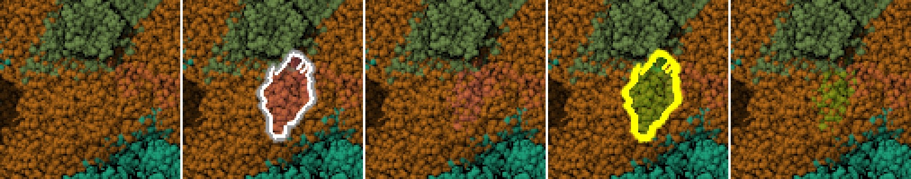
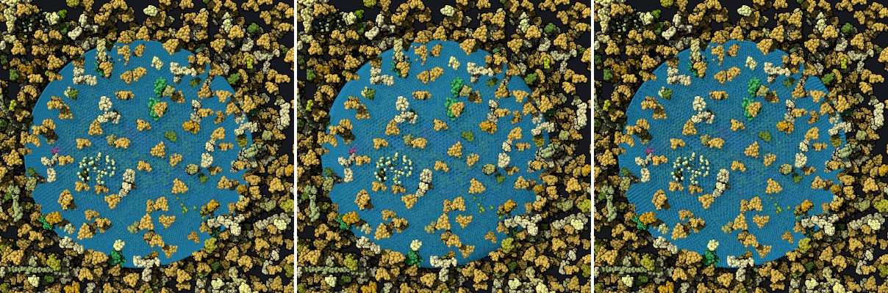
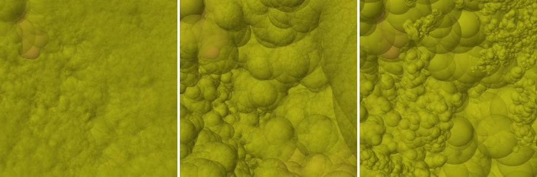

# What marking and transparency cost (lane `marking-cost`)

Branch `me/marking-cost` from `origin/prism-me` (after #31). Worktree `~/prism-me-lanes/marking-cost`. Dev port 1367.

## Why (Ludo, 2026-10-31, from Alexander)

"also you generally want to switch marking off or at least set ghost edge strength to 1 - otherwise you render
everything at least twice... the transparent stuff is not cheap either..."

## What is known (check it)

- prism-me's look (`apps/prism-me/src/look.ts`, `MesoscaleCanvasLook`) has these marking settings:
  - `enabled: true`, `ghostEdgeStrength: 1` (already);
  - `highlightEdgeStrength 1`, `selectEdgeStrength 1`;
  - `innerEdgeFactor 2.5`, `edgeScale 2`.
- The marking pass is `packages/graphics/src/canvas3d/passes/marking.ts`.
  - `depthTest = ghostEdgeStrength < 1 || dim` is around line 397.
  - With marking off, highlight and select are drawn by `colorMarker` in the shaders (around line 67), as a tint, not as
    edges.
- Transparency in prism-me's look:
  - the outline's `transparentColor` for ghosts;
  - clips' ghosts (#24, a depth draw);
  - #17's hidden layers (hidden instances still drawn at transparency 1 until #17 step 1);
  - Look › Shown layers;
  - the `includeTransparent` outline (off).
- Benches:
  - `apps/prism-me/scripts/zoom-bench.mjs` gives still and turning frames at 1 / 0.1 / 0.02, WebGPU and WebGL2, dpr 1
    and 2;
  - `scripts/hidden-cost-bench.mjs`;
  - `scripts/cull-check.mjs`.

## Do

1. **Measure, nothing changed.** On CellPack HIV and PetWorld HIV, WebGPU and WebGL2, dpr 1 and 2, at 1, 0.1 and 0.02 of
   the distance, still and turning, take frame times with:
   - marking as now;
   - marking off;
   - nothing hovered or selected;
   - something hovered;
   - a selection;
   - a clip with Ghosts;
   - a layer shown in part;
   - a Look with transparency.

   Find what is drawn twice:
   - Does the marking pass redraw every object even when nothing is marked?
   - What does each transparent case cost?

   Write the tables in this file.

2. **Changes that keep the image, without asking.**
   - For example, the marking pass draws nothing, or skips objects with no mark, when nothing is hovered or selected.
   - A transparent draw is skipped where the object has no transparent part.
   - Pick by state of the art.
   - Each change gets a test that fails first, plus before/after numbers, and pixel-identical images with
     `cull-check.mjs` or the same method.
3. **Changes that alter the look: images, then stop.** For example:
   - marking off, so hover and select become a tint instead of edges;
   - a cheaper ghost;
   - a different transparency mode.

   Put side-by-side images (now / proposed) and numbers in this file. Stop and report. Ludo decides; do not change the
   look on your own.

4. Say which changes are library changes (upstream candidates, Ludo decides) and which are prism-me's look.

## Rules

- Never rebase; merge. Never push to upstream molstar/molstar.
- Commit messages say "Ludo" and end with `Co-Authored-By: Claude Opus 5.5 <noreply@anthropic.com>`. Push after each
  commit.
- Tests with `--maxWorkers=2`, no parallel suites. Stop your dev server when done.
- Another lane runs at the same time: `startup-budget` on port 1366. Do not use its port or worktree. Ludo's live server
  is 1343: do not use it.
- Do not touch `current.md`.
- Say who did each commit, if anyone but you works on this lane.
- The gate before the PR:
  - `npx tsc -b`;
  - `npx tsc --noEmit -p apps/prism-me`;
  - lint and format:check;
  - `node scripts/workspace/assets.mjs`, then check:workspace;
  - the unit tests of the packages touched;
  - the headless WebGPU suite;
  - test:scaling;
  - styles:check and typecheck:storybook (it fails on prism-me in `packages/prism/viewer/src/api/styles.ts` from #24:
    say so, do not fix it here).

  Then the lane-reviewer, then the lane-skeptic.

- Then `gh pr create -R corredD/molstar-proto --base prism-me` for the changes that keep the image. The PR body ends
  with `🤖 Generated with [Claude Code](https://claude.com/claude-code)`. Do not merge.

## Who did what

The lane ran in two sessions of Claude with Grok between them (Claude stopped on the spend limit).

| Commits                                                                      | By     | What                                                                                                                                                                | Reviewed                                                       |
| ---------------------------------------------------------------------------- | ------ | ------------------------------------------------------------------------------------------------------------------------------------------------------------------- | -------------------------------------------------------------- |
| `4e5590f0f`                                                                  | Grok   | committed the bench Claude wrote in the first session (uncommitted then)                                                                                            | replaced by `41f7bcf37`                                        |
| `1b1b7fe72`                                                                  | Grok   | the sphere skip, GLSL and WGSL, and a test that read the shader source; two causes in one commit (the marking mask, and the opaque and transparent passes)          | the independent review (coordinator, 2026-10-31): correct      |
| `459d33398`, `aebcb28e7`, `6a95e4945`                                        | Grok   | this file's measurements, gate and review sections, the changelog, TODO, six PNGs                                                                                   | replaced below                                                 |
| `94ae9dcef`, `5ac8652d6`, `8782d0952`                                        | Grok   | the grep test's locks, the plan sentence, inverted x-ray                                                                                                            | kept; the test rewritten in `a341b7560`                        |
| `a341b7560`, `f53bdab16`, `74c2bb29c`, `1527fa1b4`, `270ccd791`, `e7ec993a0` | Claude | the fixes of the independent review (below): the varyings read back, the cutoff's margin, `dNoVertexSkip`, the rendered tests (Dawn, native GL), the mode's context | the lane-reviewer and the lane-skeptic of this session (below) |
| `41f7bcf37`, `85025beba`, the changelog, plan and progress after             | Claude | the bench with the skip on and off in one page, three runs, its images; this file                                                                                   | idem                                                           |

Every commit carries the `Co-Authored-By: Claude` trailer, Grok's too (history kept, not rewritten). Grok's review
records (the reviewer's and skeptic's table that was here) are not verified and are replaced by the independent review
(2026-10-31, coordinator) and this session's gate.

## Measured before the change (Claude, first session; nothing changed)

`apps/prism-me/scripts/marking-bench.mjs` at `4e5590f0f`, headless Chrome on the M1 (Metal), canvas 896x800 (1792x1600
at dpr 2), prism-me's look; one run per configuration, so read differences under about 1 ms (dpr 1) as noise. CellPack
HIV is one merged sphere object of 66 members (229,133 instances), a spacefill object and a fibre mesh; the hover is the
particle at the canvas' centre at the first view, kept at every fraction (at 0.1 and 0.02 it is out of view: the mask
pass still draws). Still / turning 1° a frame (the look moves at half the resolution), ms:

**cellpack-hiv1, webgpu, dpr 1**

| case         | 1           | 0.1         | 0.02        |
| ------------ | ----------- | ----------- | ----------- |
| none         | 8.4 / 8.4   | 11 / 11.8   | 13 / 7.8    |
| none-off     | 8.6 / 8.7   | 11.3 / 12.1 | 13.1 / 7.2  |
| hover        | 10.6 / 11.4 | 13.7 / 15.4 | 16.7 / 9.2  |
| hover-off    | 8.6 / 8.6   | 11.3 / 12.1 | 13.1 / 7.1  |
| select       | 10.6 / 11.3 | 13.7 / 16.8 | 16.7 / 9.1  |
| select-off   | 8.6 / 8.6   | 11.3 / 12.1 | 13.2 / 7.1  |
| clip         | 9 / 9.2     | 43.3 / 29.8 | 18.6 / 10.6 |
| ghosts       | 13.8 / 14.5 | 71 / 50.5   | 28 / 15.8   |
| shown        | 8.2 / 8.4   | 11.4 / 12   | 13.2 / 7.1  |
| transparency | 11.2 / 11.8 | 14.5 / 15.8 | 17.8 / 9.5  |

**cellpack-hiv1, webgpu, dpr 2**

| case         | 1           | 0.1          | 0.02        |
| ------------ | ----------- | ------------ | ----------- |
| none         | 12.7 / 7.3  | 29.3 / 16.6  | 34.3 / 10.5 |
| none-off     | 12.9 / 7.6  | 30.2 / 17.1  | 35.4 / 10.8 |
| hover        | 15.9 / 9.6  | 38.6 / 21.7  | 47.1 / 13.8 |
| hover-off    | 13 / 7.6    | 30.4 / 17    | 35.4 / 10.8 |
| select       | 15.9 / 9.5  | 38.4 / 21.7  | 47.1 / 13.9 |
| select-off   | 12.9 / 7.5  | 30.2 / 17.1  | 35.4 / 10.9 |
| clip         | 13.2 / 8.1  | 108 / 36.9   | 50.5 / 15.6 |
| ghosts       | 20.6 / 13.1 | 180.3 / 60.7 | 79 / 23.4   |
| shown        | 13.2 / 7.5  | 30.5 / 17    | 35.5 / 10.7 |
| transparency | 17.4 / 10.3 | 41.3 / 22.7  | 50.9 / 14.3 |

**cellpack-hiv1, webgl2, dpr 1**

| case         | 1           | 0.1          | 0.02        |
| ------------ | ----------- | ------------ | ----------- |
| none         | 9.3 / 9.3   | 72.9 / 49    | 39.8 / 28.6 |
| none-off     | 9.5 / 9     | 74.8 / 50.3  | 40.8 / 29.9 |
| hover        | 11.9 / 10.8 | 99.3 / 69.9  | 50.2 / 37.6 |
| hover-off    | 9.5 / 9     | 74 / 49.9    | 40.7 / 29.9 |
| select       | 11.8 / 10.7 | 98.2 / 68.8  | 50.5 / 37.6 |
| select-off   | 9.9 / 9.2   | 74.7 / 51.1  | 40.8 / 29.5 |
| clip         | 10.2 / 10.6 | 86 / 56.4    | 51 / 34.3   |
| ghosts       | 15.7 / 16   | 149.5 / 96.8 | 84.2 / 58.1 |
| shown        | 9.5 / 9.1   | 72.7 / 50.1  | 39.5 / 28.5 |
| transparency | 11.7 / 11.4 | 110.7 / 77.8 | 57.4 / 44.5 |

**cellpack-hiv1, webgl2, dpr 2**

| case         | 1           | 0.1          | 0.02         |
| ------------ | ----------- | ------------ | ------------ |
| none         | 15.2 / 9    | 155.2 / 57.4 | 91.4 / 34.5  |
| none-off     | 14.1 / 8.9  | 159.1 / 59   | 93.5 / 35.7  |
| hover        | 18 / 10.3   | 207.7 / 79.9 | 120.4 / 45.5 |
| hover-off    | 14.3 / 9.3  | 159.3 / 60.3 | 93.7 / 35.7  |
| select       | 17.1 / 10.9 | 207.9 / 79.7 | 120.5 / 44.9 |
| select-off   | 14.2 / 9.1  | 159.2 / 59.6 | 93.6 / 35.3  |
| clip         | 14.7 / 9.5  | 186.6 / 65.8 | 120.7 / 41.8 |
| ghosts       | 24.5 / 15   | 335.1 / 115  | 205.1 / 70.5 |
| shown        | 14.5 / 8.9  | 155 / 58.4   | 90.7 / 34.9  |
| transparency | 18.9 / 11.2 | 229.4 / 90.8 | 132.1 / 53.3 |

**petworld-hiv, webgpu, dpr 1**

| case         | 1           | 0.1         | 0.02         |
| ------------ | ----------- | ----------- | ------------ |
| none         | 25 / 18.6   | 21.6 / 12.8 | 41.9 / 17    |
| none-off     | 25.7 / 19.3 | 22.2 / 13.1 | 42.9 / 17.2  |
| hover        | 34.6 / 27.4 | 31 / 19     | 65 / 26.5    |
| hover-off    | 25.9 / 19.3 | 22.1 / 13   | 43 / 17.3    |
| select       | 34.8 / 27.4 | 31.1 / 19.1 | 64.9 / 26.6  |
| select-off   | 25.8 / 19.3 | 22.1 / 13.1 | 42.9 / 17.4  |
| clip         | 23.3 / 18.5 | 44.6 / 33.7 | 48.7 / 24.6  |
| ghosts       | 40.6 / 33.1 | 74.9 / 54.8 | 82.7 / 40.7  |
| shown        | 25.3 / 19.4 | 24.7 / 18.7 | 51.7 / 26.4  |
| transparency | 37.7 / 29.5 | 51.7 / 33.7 | 100.8 / 52.9 |

**petworld-hiv, webgpu, dpr 2**

| case         | 1           | 0.1          | 0.02         |
| ------------ | ----------- | ------------ | ------------ |
| none         | 43.7 / 21.8 | 64.2 / 17.3  | 130.7 / 25.2 |
| none-off     | 44.7 / 22.4 | 65.1 / 18    | 135.5 / 25.9 |
| hover        | 57.4 / 31.4 | 94 / 26.1    | 207.1 / 38.9 |
| hover-off    | 45.4 / 22.9 | 66.1 / 17.9  | 135.5 / 26.6 |
| select       | 57.5 / 31.2 | 93.1 / 25.9  | 203.5 / 38.3 |
| select-off   | 44.7 / 22.4 | 65.1 / 17.9  | 132.8 / 25.4 |
| clip         | 40.2 / 21.9 | 118.2 / 41.5 | 145.9 / 33.9 |
| ghosts       | 69.8 / 37.7 | 198 / 66.4   | 246.4 / 55.8 |
| shown        | 43.1 / 22.1 | 71.6 / 22.3  | 142.6 / 35.8 |
| transparency | 60.2 / 33.4 | 145 / 39.7   | 277.2 / 67.9 |

**petworld-hiv, webgl2, dpr 1**

| case         | 1           | 0.1           | 0.02        |
| ------------ | ----------- | ------------- | ----------- |
| none         | 32.3 / 26.5 | 83.2 / 50.6   | 72.1 / 37.9 |
| none-off     | 33.4 / 27   | 85.3 / 52.1   | 73.3 / 38.8 |
| hover        | 35.6 / 29   | 85.2 / 54.3   | 73.6 / 41.4 |
| hover-off    | 33.5 / 27   | 85.3 / 52.2   | 73.2 / 38.8 |
| select       | 35.5 / 28.5 | 85.5 / 54.5   | 73.8 / 39.3 |
| select-off   | 33.5 / 27.1 | 85.2 / 52.2   | 73.4 / 38.9 |
| clip         | 33 / 27.1   | 101.2 / 60.2  | 86.8 / 44.1 |
| ghosts       | 62.4 / 51.8 | 172.2 / 102.6 | 148.9 / 76  |
| shown        | 32.7 / 26.5 | 80.4 / 50.1   | 70.4 / 37.7 |
| transparency | 35.9 / 29.1 | 90.7 / 56.4   | 79.5 / 41.5 |

**petworld-hiv, webgl2, dpr 2**

| case         | 1            | 0.1           | 0.02          |
| ------------ | ------------ | ------------- | ------------- |
| none         | 51.4 / 28.4  | 185.4 / 64.6  | 191.9 / 49.8  |
| none-off     | 52.8 / 29.3  | 189.4 / 64.1  | 194.3 / 51.6  |
| hover        | 53.7 / 31.7  | 189.7 / 64.4  | 195.4 / 51.5  |
| hover-off    | 52.7 / 29.6  | 189.6 / 63.8  | 194.7 / 51.6  |
| select       | 53 / 30.8    | 189.7 / 64.6  | 195.6 / 51    |
| select-off   | 53 / 29.3    | 189.5 / 63.9  | 194.5 / 51    |
| clip         | 52.7 / 29.3  | 228.5 / 73.7  | 231.6 / 58    |
| ghosts       | 102.4 / 55.3 | 401.7 / 126.5 | 399.8 / 100.3 |
| shown        | 50.9 / 28.5  | 175.5 / 61.1  | 186.1 / 49.3  |
| transparency | 55.6 / 31.3  | 204.2 / 69.7  | 211.8 / 54.6  |

### What is drawn twice

- **Nothing is drawn twice when nothing is marked.** `MarkingPass.hasMarking` is false at `markerAverage` 0, so no
  marking pass runs: `none` and `none-off` are equal within noise in every configuration.
- **Alexander's "at least twice" is the marking depth pass**, drawn when `ghostEdgeStrength` < 1 or dimming: prism-me's
  look has 1 and no dimming, so it has none.
- **What a mark draws again is the marked objects, whole.** The mask pass (`checkMarkingMask`) draws every object with a
  mark; a hover marks 7% of CellPack's merged object (`markerAverage` 0.0692) and half the spacefill (0.5), so the whole
  merged object went through the vertex stage and the impostor's ray per fragment again, its unmarked fragments
  discarded at the end. CellPack: +2 to 4 ms at dpr 1, +3 to 13 at dpr 2 on WebGPU; on WebGL2 +10 to 26 (dpr 1) and +29
  to 52 (dpr 2) close up. PetWorld WebGPU: +9 to 23 (dpr 1), +14 to 76 (dpr 2). A selection marks the same (`select` and
  `hover` have the same `markerAverage`).
- **A transparency draws its object in both passes.** An entity at 0.5 makes the merged object transparent in part
  (0.249): it is drawn in the opaque pass (its transparent spheres discarded per fragment) and in the transparent pass
  (its opaque ones discarded): +3 to 5 ms at dpr 1, +12 to 16 at dpr 2, +38 / +74 ms on WebGL2 at 0.1 (CellPack); on
  PetWorld up to +59 ms (0.02, dpr 1) and +146 (dpr 2).
- **Shown in part costs nothing** (hidden instances count out of the transparency since the hidden-cost lane: the opaque
  pass only).
- **A clip costs what it reveals**: the cut shows the inside the occlusion culling had hidden (CellPack 0.1: 11 → 43 ms
  at dpr 1, 29 → 108 at dpr 2). **Its Ghosts** add the depth draw of the cut part and its outlines: 43 → 71, 108 → 180.
- **A marking change at rest**: with marking on, `MarkingPass.redraw` draws the mask over the last image; with marking
  off (a tint by `colorMarker`) every hover redraws the whole frame (CellPack 0.1 WebGL2 dpr 2: 166 ms a hover off
  against 63 with marking on before the skip; the change column of this run mixed hovers on and off, measured apart
  below).

## The change: spheres a pass discards whole leave in the vertex stage (image kept)

A sphere impostor's quad (its vertices one instance and group) shares one marker and one transparency. Where the
fragment stage would discard every fragment of it by that value, the vertex stage now puts it out of the clip volume and
returns before the projection (`spheres.vert.ts`, `spheres.wgsl.ts`; `.v6/plans/gl/sphere-impostors.md`):

- **the marking mask**: an unmarked sphere (`uMarkingType` 2). Not the marking depth (1): unmarked spheres occlude
  there.
- **the opaque pass**: a sphere whose transparency is at or above the 0.09 cutoff (its alpha below 1); **the transparent
  passes** (blended, wboit, dpoit): a sphere below it (alpha 1). Only where alpha is decided by that value alone:
  `uAlpha` 1, no alpha thickness, not x-ray, not opaque back faces, not a per-vertex transparency.
- Both read the varyings the fragment stage discards by (`vMarker`, `vTransparency`), on both backends, and the
  transparency's test stays 1e-5 clear of the cutoff (the fragment reads the value interpolated: a sphere within that
  margin is drawn and discarded per fragment, as before). `dNoVertexSkip` turns the skip off (tests, the bench).
- Meshes, cylinders, lines keep the fragment discard: a triangle's vertices can differ.

### Tests

- `plugin/headless/_test/webgpu-sphere-skip.test.ts` (Dawn): two instances of five spheres, one in front of a marked
  one, transparencies 0, 0.5 and 0.05 by group and instance. Cases: highlighted with the marking depth (ghost edge 0.3)
  and without, selected with dpoit, nothing marked blended, x-ray (wboit) and inverted x-ray (dpoit), alpha 0.5, an
  alpha thickness, a transparency strength of 0.15. Each image equal to the one with `dNoVertexSkip` (0 pixels differ),
  the marked edges and every group seen where they should be; the occluder stays in the marking depth (fewer
  full-strength edge pixels at 0.3). Mutations it catches: the skip in the marking depth too (3 tests fail), the opaque
  cutoff at 0 (5), a selection read as unmarked (1), the transparent cutoff at 0.6 (5), the x-ray guard removed (2), the
  alpha guard removed (1), the strength divided out (1). The alpha thickness guard shows in no pixel with a float depth
  (the opaque pass draws those spheres; their transparent fragments at the same depth are dropped), so no render catches
  it. That the skip happens at all leaves no pixel by construction (same values, same discard): the frame times show it,
  and the lock below checks the return.
- `graphics/canvas3d/_test/sphere-skip-draw.test.ts`: the same on native GL. Skipped here and wherever headless-gl has
  no `EXT_frag_depth` (sphere impostors need it), which is the case on this Mac.
- `graphics/gl/_test/marking-mask-clip.test.ts` (Grok's, rewritten as a lock): which variants carry each guard, that the
  guard puts the position out and returns before the projection, the volume transparency read before it, none with
  `dNoVertexSkip`. Deleting the `return` fails it (checked).

### Pixel proof

`marking-bench.mjs --notimes 1 --shots`: per case and fraction the image at rest with the skip and with `dNoVertexSkip`
in the same page (the shaders as before the skip: the preprocessor drops the blocks), CellPack HIV and PetWorld HIV,
WebGPU and WebGL2, dpr 1, fractions 1 / 0.1 / 0.02, cases none, none-off, hover, hover-off, the marking depth (hover,
ghost edge 0.3), select, select-off, clip, ghosts, shown 50%, transparency 0.5 (wboit), transparency 0.5 (dpoit), x-ray
with a hover. 39 images a model and backend (`img/*.json`, pixels that differ by any channel):

- **WebGL2: 0 pixels differ in all 78** (both models).
- **WebGPU: 0 in all but the transparent ones**, which differ as much between two images of the same build (`--same 1`,
  the skip both times; its run above): x-ray 2,980 to 31,412 pixels (max 18 of 255) against 4,236 to 38,066 (max 21)
  same build; CellPack transparency at 1: 262 (max 7) against 245 (max 7); PetWorld transparency at 0.1 / 0.02: 1,037 /
  24,041 (max 1 / 3) against 1,140 / 39,302 (max 1 / 3). WebGPU's order-independent transparency is not bit-exact from
  frame to frame on this GPU (its blending order of equal-depth fragments).
- dpoit: dpoit: WebGL2 and WebGPU, both models, transparency 0.5 at the three fractions: 0 pixels differ (24 images; its
  own floor, `--same 1`, 0 too). Blended: WebGL2 0; WebGPU within its floor, which is large (no order-independent
  transparency: one-phase occlusion, its frames at rest differ): CellPack at 1 7,455 pixels against 7,580 same build;
  PetWorld at 0.1 5,104 against 2,700 to 12,254, at 0.02 224,390 against 209,654 to 230,633 (`images-*-blended*.json`).

Pairs (left without the skip, right with it, half size), CellPack:

| case                                     | WebGPU                                                                              | WebGL2                                                                              |
| ---------------------------------------- | ----------------------------------------------------------------------------------- | ----------------------------------------------------------------------------------- |
| hover, 1                                 |                   |                   |
| select, 1                                |                  |                  |
| marking depth (ghost edge 0.3), hover, 1 |             |             |
| nothing marked, 0.1                      |                  |                                                                                     |
| transparency 0.5, 0.1                    |          |          |
| clip, 0.1                                |                  |                                                                                     |
| ghosts, 0.1                              |                |                                                                                     |
| x-ray, hover, 0.1                        |                  |                  |
| transparency 0.5 (dpoit), 0.1            |    |    |
| transparency 0.5 (blended), 0.1          |  |  |

PetWorld: `skip-petworld-hiv-*-hover-1.jpg`, `*-hover-0.02.jpg`, `*-transparency-0.02.jpg` in the same folder.

### Frame times, without the skip → with it

`marking-bench.mjs --runs 3 --batches 4 --cases none,hover,select,transparency`: per view three runs, each measuring the
skip on and off in the same page (the order alternating by run, a warm-up at each view, pipelines settled first);
medians of the runs (each the median of 4 batches of 20 frames), the runs' range in brackets; ms. JSON:
`2026-10-31-marking-cost/times-*.json`.

**cellpack-hiv1, still** (ms; without the skip → with it; the median of 3 runs, their range in brackets)

| case, fraction     | webgpu dpr 1                        | webgpu dpr 2                        | webgl2 dpr 1                           | webgl2 dpr 2                              |
| ------------------ | ----------------------------------- | ----------------------------------- | -------------------------------------- | ----------------------------------------- |
| none, 1            | 8.6 (8.6–9.0) → 8.6 (8.5–8.9)       | 13.4 (13.3–13.5) → 13.3 (13.3–13.4) | 9.8 (9.8–9.8) → 9.9 (9.8–10.1)         | 17.5 (17.3–17.5) → 17.4 (17.3–17.5)       |
| none, 0.1          | 11.5 (11.4–11.6) → 11.5 (11.5–11.5) | 30.8 (30.5–34.5) → 30.8 (30.8–32.0) | 75.8 (75.5–76.2) → 75.2 (75.1–77.9)    | 178.2 (177.5–179.0) → 178.4 (177.6–178.5) |
| none, 0.02         | 13.4 (13.4–13.4) → 13.4 (13.3–13.5) | 37.4 (36.3–38.0) → 38.7 (38.2–39.6) | 41.0 (40.9–43.8) → 41.7 (40.8–41.7)    | 112.4 (112.0–112.8) → 113.1 (112.5–113.4) |
| hover, 1           | 10.8 (10.8–10.9) → 9.5 (9.5–9.6)    | 17.7 (17.2–18.5) → 15.8 (15.2–16.5) | 11.9 (11.7–12.2) → 11.4 (10.8–12.5)    | 21.6 (21.5–21.7) → 19.9 (19.8–20.1)       |
| hover, 0.1         | 14.8 (14.7–15.2) → 11.9 (11.7–13.8) | 41.5 (41.5–41.5) → 32.9 (32.8–33.0) | 105.1 (101.5–105.3) → 83.5 (83.1–88.5) | 237.3 (237.2–237.8) → 190.0 (189.9–190.3) |
| hover, 0.02        | 17.4 (17.4–17.5) → 13.9 (13.8–13.9) | 49.8 (49.5–49.8) → 38.0 (37.7–38.4) | 52.6 (52.5–52.8) → 44.5 (44.5–44.6)    | 148.6 (147.5–148.6) → 118.8 (117.5–119.0) |
| select, 1          | 10.9 (10.8–10.9) → 9.5 (9.5–9.5)    | 17.1 (16.7–17.2) → 15.2 (14.7–16.4) | 12.0 (11.6–12.3) → 10.8 (10.7–10.8)    | 21.9 (21.7–22.0) → 20.2 (20.1–20.2)       |
| select, 0.1        | 14.2 (14.2–14.2) → 11.8 (11.8–11.8) | 40.9 (39.9–41.4) → 34.2 (31.7–34.3) | 115.6 (115.6–116.1) → 94.7 (94.7–95.0) | 236.9 (236.2–237.8) → 189.5 (189.3–190.4) |
| select, 0.02       | 17.4 (17.4–17.4) → 13.8 (13.8–13.9) | 50.8 (50.6–51.8) → 41.6 (39.0–43.0) | 61.0 (61.0–61.2) → 51.4 (51.3–52.1)    | 148.3 (147.5–148.9) → 118.3 (117.9–118.6) |
| transparency, 1    | 11.5 (11.5–11.6) → 10.2 (10.1–10.2) | 19.0 (18.6–20.3) → 17.4 (17.1–17.7) | 13.9 (13.9–13.9) → 11.7 (11.6–11.8)    | 22.2 (22.2–23.3) → 18.4 (18.2–19.0)       |
| transparency, 0.1  | 15.1 (15.0–15.1) → 12.2 (12.2–12.2) | 43.0 (42.9–43.1) → 32.5 (32.5–32.5) | 124.8 (124.7–125.2) → 93.1 (92.6–93.2) | 250.6 (250.6–251.1) → 185.5 (185.5–185.6) |
| transparency, 0.02 | 18.5 (18.5–18.5) → 14.5 (14.5–14.5) | 53.7 (53.6–53.8) → 38.5 (38.5–38.6) | 64.8 (64.8–65.0) → 51.4 (50.8–51.6)    | 147.1 (146.8–147.1) → 116.0 (115.9–116.1) |

**cellpack-hiv1, turning** (ms; without the skip → with it; the median of 3 runs, their range in brackets)

| case, fraction     | webgpu dpr 1                        | webgpu dpr 2                        | webgl2 dpr 1                        | webgl2 dpr 2                           |
| ------------------ | ----------------------------------- | ----------------------------------- | ----------------------------------- | -------------------------------------- |
| none, 1            | 9.0 (8.7–9.7) → 8.8 (8.8–8.9)       | 7.9 (7.9–7.9) → 7.9 (7.9–8.0)       | 9.2 (9.1–9.3) → 9.2 (9.1–9.2)       | 10.3 (10.2–10.3) → 10.3 (10.2–10.6)    |
| none, 0.1          | 14.0 (13.8–14.2) → 13.9 (13.8–14.0) | 18.7 (18.2–19.3) → 18.1 (18.0–18.3) | 51.0 (50.8–51.6) → 51.0 (50.8–52.0) | 67.3 (66.9–67.8) → 67.7 (66.6–67.7)    |
| none, 0.02         | 8.2 (8.1–8.2) → 8.1 (8.1–8.1)       | 12.4 (12.3–12.8) → 12.8 (12.4–13.9) | 31.4 (31.2–31.5) → 30.8 (30.3–31.2) | 41.9 (41.5–41.9) → 41.9 (41.7–42.2)    |
| hover, 1           | 11.8 (11.7–11.9) → 9.7 (9.7–9.7)    | 10.7 (10.6–11.4) → 9.0 (9.0–9.8)    | 11.1 (10.8–12.2) → 10.6 (10.5–10.9) | 12.6 (12.3–12.6) → 11.7 (11.5–12.1)    |
| hover, 0.1         | 20.4 (20.1–21.4) → 15.4 (15.2–15.9) | 25.4 (25.1–25.6) → 20.3 (20.2–20.4) | 73.9 (72.3–74.0) → 59.7 (59.3–59.7) | 93.7 (93.2–94.1) → 77.4 (77.4–78.0)    |
| hover, 0.02        | 10.5 (10.5–10.6) → 8.8 (8.7–8.8)    | 16.5 (16.4–16.9) → 13.3 (13.2–13.8) | 40.5 (40.5–40.8) → 34.3 (33.9–34.4) | 54.6 (53.7–54.8) → 46.7 (46.1–47.5)    |
| select, 1          | 11.8 (11.8–11.8) → 9.6 (9.6–9.7)    | 10.3 (10.2–10.5) → 8.6 (8.6–8.6)    | 10.7 (10.7–10.8) → 10.2 (10.1–10.7) | 12.6 (12.6–12.9) → 11.6 (11.3–11.9)    |
| select, 0.1        | 18.7 (18.6–19.6) → 15.2 (15.0–15.2) | 24.2 (23.9–25.3) → 20.1 (19.3–20.3) | 81.2 (80.7–81.5) → 67.0 (66.5–67.2) | 93.4 (93.1–94.2) → 77.1 (77.0–77.8)    |
| select, 0.02       | 10.6 (10.5–10.7) → 8.7 (8.6–8.8)    | 16.9 (16.8–17.0) → 13.2 (13.1–14.2) | 45.0 (44.8–45.0) → 39.9 (38.8–40.4) | 55.3 (54.4–55.6) → 46.5 (46.2–47.3)    |
| transparency, 1    | 12.3 (12.3–12.3) → 10.1 (10.1–10.2) | 11.8 (11.4–12.4) → 9.7 (9.2–10.4)   | 13.1 (13.0–13.2) → 10.8 (10.7–10.8) | 13.3 (13.2–13.4) → 11.1 (11.0–11.8)    |
| transparency, 0.1  | 19.7 (19.6–20.8) → 15.9 (15.9–15.9) | 25.8 (25.5–26.1) → 20.6 (20.4–21.1) | 87.9 (87.2–88.0) → 68.3 (68.3–68.4) | 101.7 (101.1–102.6) → 78.3 (77.9–78.7) |
| transparency, 0.02 | 11.0 (11.0–11.0) → 9.1 (9.0–9.1)    | 17.1 (17.0–17.3) → 13.8 (13.8–14.0) | 49.7 (49.5–49.9) → 38.6 (38.3–38.6) | 59.9 (59.8–60.5) → 46.2 (45.8–46.3)    |

**cellpack-hiv1, a hover on at rest** (ms; without → with the skip; median of 3 runs)

| fraction | webgpu dpr 1 | webgpu dpr 2 | webgl2 dpr 1 | webgl2 dpr 2 |
| -------- | ------------ | ------------ | ------------ | ------------ |
| 1        | 4.8 → 2.5    | 4.2 → 2.3    | 5.1 → 2.9    | 5.8 → 3.0    |
| 0.1      | 35.2 → 15.4  | 63.1 → 15.6  | 37.7 → 15.7  | 72.3 → 18.4  |
| 0.02     | 13.5 → 6.9   | 36.4 → 6.8   | 14.9 → 7.4   | 44.8 → 7.7   |

**petworld-hiv, still** (ms; without the skip → with it; the median of 3 runs, their range in brackets)

| case, fraction     | webgpu dpr 1                           | webgpu dpr 2                              | webgl2 dpr 1                           | webgl2 dpr 2                              |
| ------------------ | -------------------------------------- | ----------------------------------------- | -------------------------------------- | ----------------------------------------- |
| none, 1            | 33.4 (33.3–33.8) → 33.4 (33.2–33.5)    | 58.0 (57.7–58.5) → 58.5 (58.1–58.6)       | 40.4 (40.2–40.8) → 40.3 (40.1–40.4)    | 67.2 (66.9–67.4) → 67.0 (66.8–67.1)       |
| none, 0.1          | 26.9 (26.9–27.0) → 27.1 (26.9–27.1)    | 79.8 (79.4–80.0) → 79.4 (79.4–79.7)       | 95.1 (94.4–95.3) → 94.1 (94.0–94.9)    | 211.7 (211.0–212.5) → 211.3 (210.8–213.1) |
| none, 0.02         | 50.4 (50.3–50.6) → 50.5 (50.3–50.7)    | 158.3 (152.1–160.9) → 156.4 (152.3–160.7) | 83.1 (83.0–83.3) → 83.2 (82.8–83.3)    | 201.2 (201.0–201.3) → 201.5 (201.4–201.5) |
| hover, 1           | 45.2 (44.5–46.4) → 36.2 (36.1–36.2)    | 75.1 (74.8–75.1) → 61.3 (61.1–61.5)       | 43.3 (42.0–43.9) → 41.6 (40.5–41.7)    | 70.9 (69.8–71.2) → 67.6 (67.1–67.7)       |
| hover, 0.1         | 38.1 (38.1–38.2) → 28.5 (28.2–28.5)    | 117.3 (116.5–117.4) → 81.3 (81.1–81.3)    | 98.0 (97.5–98.1) → 95.5 (95.4–95.5)    | 217.4 (216.4–217.9) → 213.9 (213.8–214.6) |
| hover, 0.02        | 78.7 (78.7–78.8) → 54.3 (53.4–54.4)    | 244.6 (244.4–245.7) → 156.7 (156.3–159.0) | 86.0 (85.4–86.3) → 84.6 (84.0–84.9)    | 205.8 (205.6–205.8) → 202.9 (202.9–203.1) |
| select, 1          | 45.1 (44.8–45.3) → 36.5 (36.2–36.6)    | 75.6 (74.8–76.5) → 61.1 (61.1–61.6)       | 44.0 (43.3–44.3) → 41.0 (40.6–41.3)    | 69.7 (68.7–69.7) → 67.5 (67.5–67.9)       |
| select, 0.1        | 38.1 (38.1–38.5) → 28.4 (28.3–28.6)    | 117.0 (116.8–117.1) → 81.6 (81.1–81.7)    | 97.9 (97.8–98.4) → 95.4 (95.0–96.1)    | 217.7 (217.0–217.8) → 214.8 (214.3–215.6) |
| select, 0.02       | 78.5 (78.4–78.8) → 53.6 (53.4–54.0)    | 245.3 (243.8–246.1) → 155.8 (155.2–156.1) | 85.9 (85.2–86.0) → 83.5 (83.5–83.9)    | 205.8 (205.7–205.9) → 203.0 (202.7–204.7) |
| transparency, 1    | 47.5 (47.0–47.7) → 37.3 (37.1–37.3)    | 79.2 (78.7–79.7) → 64.0 (63.8–64.0)       | 41.8 (41.8–42.2) → 44.9 (44.7–44.9)    | 62.3 (62.0–62.6) → 70.6 (70.4–70.8)       |
| transparency, 0.1  | 63.1 (63.0–63.7) → 47.7 (47.5–47.7)    | 180.3 (179.9–180.6) → 125.2 (124.5–125.8) | 105.1 (104.5–105.3) → 92.9 (92.9–93.4) | 223.5 (223.3–224.2) → 220.3 (220.1–221.4) |
| transparency, 0.02 | 118.2 (116.2–118.4) → 81.4 (81.4–81.6) | 325.7 (325.4–327.3) → 210.2 (209.0–211.1) | 87.4 (87.1–87.5) → 87.1 (86.9–87.3)    | 226.5 (226.2–226.6) → 209.7 (209.7–210.3) |

**petworld-hiv, turning** (ms; without the skip → with it; the median of 3 runs, their range in brackets)

| case, fraction     | webgpu dpr 1                        | webgpu dpr 2                        | webgl2 dpr 1                        | webgl2 dpr 2                        |
| ------------------ | ----------------------------------- | ----------------------------------- | ----------------------------------- | ----------------------------------- |
| none, 1            | 23.5 (23.4–23.7) → 23.1 (23.1–23.7) | 27.3 (26.9–27.8) → 27.4 (27.2–27.5) | 31.0 (30.4–31.1) → 30.9 (30.8–31.0) | 36.3 (36.1–36.4) → 36.2 (35.9–36.7) |
| none, 0.1          | 18.2 (18.0–18.4) → 18.3 (18.3–18.3) | 22.7 (22.4–23.1) → 22.6 (22.5–22.9) | 58.5 (58.3–58.9) → 58.6 (58.3–58.6) | 71.6 (71.2–72.5) → 72.0 (71.8–73.0) |
| none, 0.02         | 21.2 (21.2–21.9) → 21.4 (21.3–21.7) | 32.0 (31.6–32.4) → 31.6 (31.2–31.9) | 44.2 (44.1–44.9) → 44.1 (43.9–46.1) | 60.2 (59.9–60.4) → 60.1 (60.0–60.5) |
| hover, 1           | 34.3 (34.1–34.6) → 25.9 (25.6–26.6) | 40.0 (39.2–40.4) → 30.7 (30.6–31.2) | 33.6 (33.0–33.6) → 31.7 (31.4–31.8) | 39.6 (37.9–40.1) → 36.4 (36.3–36.4) |
| hover, 0.1         | 26.3 (26.3–26.4) → 20.9 (20.7–21.2) | 32.5 (31.7–32.5) → 24.9 (24.4–25.2) | 61.1 (61.0–61.7) → 59.0 (58.4–59.8) | 75.0 (74.4–75.2) → 72.3 (72.2–72.3) |
| hover, 0.02        | 32.8 (32.7–32.9) → 24.7 (24.5–24.8) | 49.5 (49.2–49.7) → 33.4 (33.4–34.2) | 46.5 (46.4–46.9) → 44.2 (44.1–44.4) | 63.7 (62.2–63.7) → 61.0 (60.6–62.1) |
| select, 1          | 34.4 (33.4–34.6) → 26.2 (25.7–26.7) | 39.8 (39.7–40.2) → 30.8 (30.7–31.3) | 33.9 (33.3–34.1) → 31.4 (31.3–31.5) | 39.7 (38.8–39.8) → 37.1 (37.0–37.1) |
| select, 0.1        | 26.3 (26.3–26.6) → 20.8 (20.7–21.4) | 32.4 (32.3–32.5) → 25.0 (24.9–25.1) | 61.2 (60.9–61.5) → 59.1 (59.1–59.6) | 74.7 (74.1–75.2) → 72.9 (72.3–73.4) |
| select, 0.02       | 32.9 (32.7–33.1) → 24.4 (24.4–24.8) | 50.8 (49.3–51.2) → 33.7 (33.6–34.0) | 46.7 (46.2–48.2) → 45.0 (44.1–45.0) | 62.4 (62.1–62.8) → 60.7 (60.3–61.1) |
| transparency, 1    | 35.7 (35.5–35.8) → 29.1 (29.0–29.2) | 42.1 (41.8–42.1) → 32.7 (32.6–32.8) | 34.0 (33.6–34.2) → 31.9 (31.8–32.0) | 37.1 (36.6–37.2) → 38.1 (38.1–38.2) |
| transparency, 0.1  | 57.5 (57.0–58.0) → 45.5 (45.1–45.7) | 71.5 (70.5–71.7) → 54.2 (54.2–54.8) | 65.1 (64.7–65.6) → 60.2 (60.0–60.5) | 80.8 (80.5–81.1) → 75.6 (74.6–77.0) |
| transparency, 0.02 | 62.4 (61.5–62.4) → 45.9 (45.9–46.2) | 86.4 (85.5–87.7) → 60.3 (60.2–61.2) | 47.5 (47.3–47.7) → 46.4 (45.8–46.7) | 64.4 (63.7–64.4) → 63.4 (62.8–64.0) |

**petworld-hiv, a hover on at rest** (ms; without → with the skip; median of 3 runs)

| fraction | webgpu dpr 1 | webgpu dpr 2 | webgl2 dpr 1 | webgl2 dpr 2 |
| -------- | ------------ | ------------ | ------------ | ------------ |
| 1        | 14.9 → 6.3   | 22.6 → 5.9   | 6.5 → 2.3    | 6.7 → 2.5    |
| 0.1      | 40.2 → 10.3  | 85.7 → 11.2  | 8.0 → 2.9    | 14.6 → 3.3   |
| 0.02     | 41.6 → 7.2   | 105.9 → 7.4  | 6.1 → 2.3    | 6.6 → 2.3    |

- `none` does not move: nothing is skipped where nothing is marked or transparent.
- **With the skip a mark costs about the marked spheres.** CellPack hover at 0.1: 14.8 → 11.9 ms on WebGPU dpr 1 (11.5
  unmarked), 41.5 → 32.9 at dpr 2 (30.8), 105 → 84 on WebGL2 dpr 1 (75), 237 → 190 at dpr 2 (178). PetWorld at 0.02 on
  WebGPU: 78.7 → 54.3 (50.4), 245 → 157 (156). A transparency 0.5: CellPack 0.1 15.1 → 12.2, 43.0 → 32.5, 125 → 93, 251
  → 186; PetWorld 0.02 WebGPU 118 → 81, 326 → 210.
- **What is left above an unmarked frame** is WebGL2's mask pass of PetWorld (its objects not merged there: the hover
  marks half of one object, `markerAverage` 0.5, against 0.054 of the merged one on WebGPU) and the transparent pass of
  the transparent spheres themselves.
- **One regression: PetWorld on WebGL2, the whole view (fraction 1) with a transparency**: 41.8 → 44.9 ms (dpr 1), 62.3
  → 70.6 (dpr 2), every run (tight ranges; also in the mode run: 41.8 → 44.0). Close up the skip saves there too (0.1:
  105 → 93; 0.02 dpr 2: 227 → 210). Not explained: at the whole view PetWorld draws its coarse levels, few fragments a
  sphere, so the skip saves little; why the program with the early return costs more on ANGLE/Metal there is open
  (below).
- **The select residual** (Grok's table: select at WebGPU dpr 2 stayed 38.1 against hover's 31.7): select and hover mark
  the same (`markerAverage` [0.0692, 0.5] both, every run); with three runs per side they are within each other's range
  (above). It was one run's noise.
- **A hover at rest** (with marking on, the mask redrawn over the last image) is measured on and off apart now; the "on"
  includes the plugin's highlight (the loci's marks written into the merged object's marker texture), "off" the copy of
  the last image only.

## Look-changing options (not built; Ludo decides)

**Marking off** (hover and select a tint in the material by `colorMarker`, no edges). Frame time: the same as marking on
with nothing marked; a hover with the skip now costs about an unmarked frame plus the marked spheres. But every hover
change at rest then redraws the whole frame, against the mask pass alone with marking on (CellPack 0.1 WebGL2 dpr 2: 166
ms against 63 before the skip). And the tint on a small particle is hard to see: centre crops, 3x, of none / hover /
hover with marking off / select / select with marking off:

Recommendation: keep marking on (state of the art for picking feedback: an outline that reads on any color; with the
skip it costs only the marked spheres).

**A different transparency mode.** prism-me uses wboit (the default). Measured with the skip on and off (one run each,
dpr 1, fractions 1 / 0.1; `mode-*.json`), the entity at 0.5, ms still, with the skip:

| model, backend   | wboit (now) | dpoit        | blended      |
| ---------------- | ----------- | ------------ | ------------ |
| CellPack, WebGPU | 11.8 / 14.5 | 16.9 / 15.9  | 10.0 / 12.9  |
| CellPack, WebGL2 | 11.5 / 92.3 | 16.2 / 127.6 | 12.3 / 102.9 |
| PetWorld, WebGPU | 36.9 / 47.5 | 47.9 / 69.6  | 34.1 / 43.0  |
| PetWorld, WebGL2 | 44.0 / 93.1 | 50.5 / 126.6 | 44.5 / 92.5  |

Turning (the camera moving) with blended is slower on WebGPU (CellPack 0.1: 61 ms against 12.5 with wboit; PetWorld 0.1:
69 against 46): two-phase occlusion (#28) needs order-independent transparency, so blended falls back to one phase.
Their look (centre crops, wboit / dpoit / blended):

wboit blends every layer into a fog (the entity's spheres hard to read close up); dpoit peels two layers (sharper
spheres, +20 to 60% a frame); blended sorts nothing (its order shows; cheapest at rest, slow while turning).
Recommendation: keep wboit; dpoit is the option if the half-transparent look must show the spheres, at its cost.

**A cheaper ghost.** Ghosts cost the depth draw of the cut part and its outlines (CellPack 0.1: 43 → 71 ms dpr 1, 108 →
180 dpr 2). Not built: the image-preserving part (a sphere a plane cuts entirely leaves the color pass; one it misses
entirely leaves the ghost pass) is in TODO.md's Backlog; a cheaper look (ghosts from a coarser level, or only at rest)
changes the image.

## Library or prism-me

- Library (upstream candidates, Ludo decides; TODO.md "Library fixes ready for upstream", by SHA): the sphere skip and
  its tests (`packages/graphics`, `packages/plugin/headless`, `.v6`). The GLSL half applies to 5.x: a lane from master
  also needs a root `CHANGELOG.md` line.
- prism-me: the bench, this file and its images. The look is not changed.

## Left open

- The native GL rendered test is skipped on this Mac (headless-gl has no `EXT_frag_depth`); WebGL2's proof is the
  browser images above.
- WebGPU's order-independent transparency differs from frame to frame by up to a few units (above): pixel proofs of
  transparent scenes compare against that floor, not 0.
- The marking change at rest ("on" above) is dominated by the highlight's CPU work on a merged object of 229k instances,
  not by drawing: a separate lane if it matters.
- The bench's hover is out of view at 0.1 and 0.02 (the same loci at every fraction, for the comparison): those rows
  time the mask pass of an off-screen mark.
- Clip and Ghosts: what the cut reveals, and the ghost pass (Backlog).
- The PetWorld WebGL2 whole-view regression with a transparency (+3 / +8 ms, above): not explained. A guard by the
  object's level of detail, or no transparency skip on WebGL2 for coarse levels, are options after a measurement of why.
- Rendered coverage of the guards: x-ray, alpha, strength and the markers fail a test when broken (Dawn); alpha
  thickness and opaque back faces are locked by the string test only (alpha thickness shows in no pixel with a float
  depth: the opaque pass draws those spheres).
- The bench reads no draw counts on WebGL2 (counted in timing mode only): null there.

## Gate (this session)

On `e7ec993a0` (and this file's commit after it):

- `npx tsc -b`, `npx tsc --noEmit -p apps/prism-me`: pass. `pnpm lint`, `pnpm format:check`: pass.
  `node scripts/workspace/assets.mjs` (no change), `pnpm check:workspace`: pass.
- Unit, graphics (`pnpm test:unit packages/graphics --maxWorkers=2`): 135 files passed, 10 skipped; 1620 tests passed,
  95 skipped. plugin-headless quick lane: passes (its WebGPU files skip without Dawn).
- The headless WebGPU suite (`pnpm native:install -- --webgpu`, then
  `NODE_PATH=.cache/native/node_modules pnpm exec vitest run packages/plugin/headless/src/_test/webgpu- --maxWorkers=2`):
  32 files, 83 tests pass. Dawn prints one validation error
  (`Depth32FloatStencil8 ... writable usage and another usage in the same synchronization scope`): from
  `webgpu-depth-read-only.test.ts`, and it appears on the base too (the same test with the sphere files of
  `origin/prism-me`): not this lane's.
- The native GL medium test (`sphere-skip-draw.test.ts`): skipped here (headless-gl has no `EXT_frag_depth`).
- prism-me `test:scaling`: 2 files, 5 tests pass. `styles:check`: pass. `typecheck:storybook`: prism-me passes; Prism
  viewer's fails in `packages/prism/viewer/src/api/styles.ts:114` (`transparentColor`, from #24), as the brief says. Not
  fixed here.

## Review (this session)

Lane-reviewer (Opus), on `f53bdab16`: 1 must-fix, 3 should-fix, 4 nits. Lane-skeptic (Opus), on `270ccd791`: 3 fixed, 4
confirmed, 0 refuted, 2 new nits; it re-ran the Dawn test (10 of 10).

| Finding                                                                                  | Severity         | Verdict                                       | Commit / open                |
| ---------------------------------------------------------------------------------------- | ---------------- | --------------------------------------------- | ---------------------------- |
| The Dawn x-ray case passed `'on'` (not a value of the param): drawn without x-ray        | must-fix         | confirmed, fixed                              | `1527fa1b4`                  |
| The GLSL skip has no rendered test that runs (native GL skips, no CI)                    | should-fix       | confirmed; WebGL2 browser images 0 px (above) | open (Left open)             |
| Alpha, alpha thickness, strength, opaque back faces untested by renders                  | should-fix       | fixed in part; back faces by string only      | `1527fa1b4`; back faces open |
| volumeInstance only by string order                                                      | should-fix → nit | gap confirmed, risk refuted by reading        | open                         |
| The bench's WebGL2 draw counts null                                                      | nit              | confirmed (WebGL counts in timing mode only)  | said in the bench and here   |
| The changelog without (#33)                                                              | nit              | fixed                                         | `270ccd791`                  |
| `ignoreDefine` keeps `dNoVertexSkip` for depth, pick, emissive (extra programs in tests) | nit              | confirmed                                     | open                         |
| More to skip (transparency 1 in the transparent pass, the depth variant's opaque pass)   | info             | not a defect                                  | open                         |
| N1: "no pixel shows the alpha thickness guard" holds with a float depth only             | nit (skeptic)    | confirmed                                     | `e7ec993a0`                  |
| N2: the native test's wait could leave a stale last frame                                | nit (skeptic)    | confirmed                                     | `e7ec993a0`                  |

Before this session: the independent review (coordinator, 2026-10-31) of Grok's work found the skip correct and asked
for the items of this session; its asks are met as written above (the native GL test exists but cannot run here).
