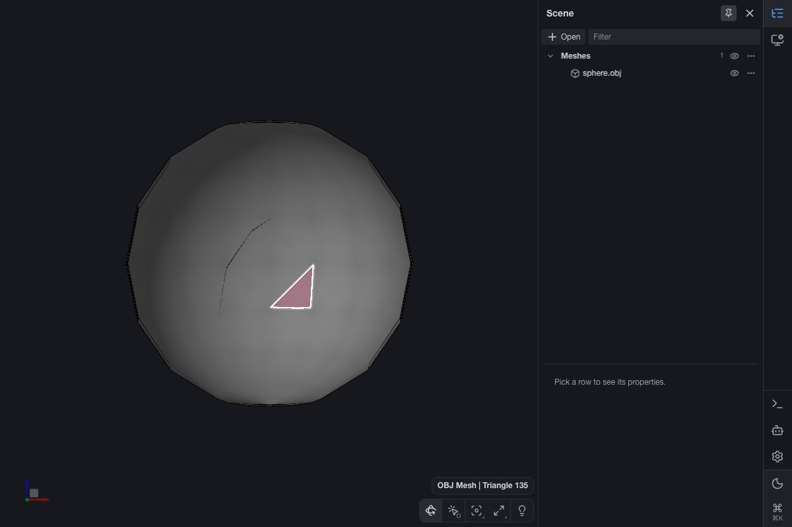
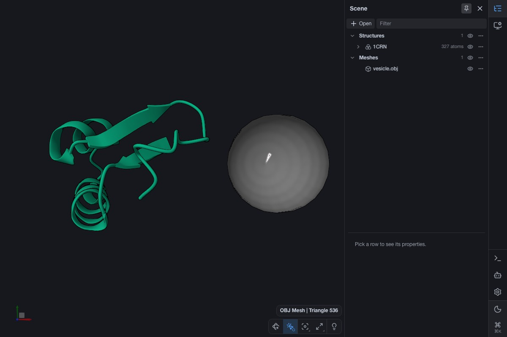
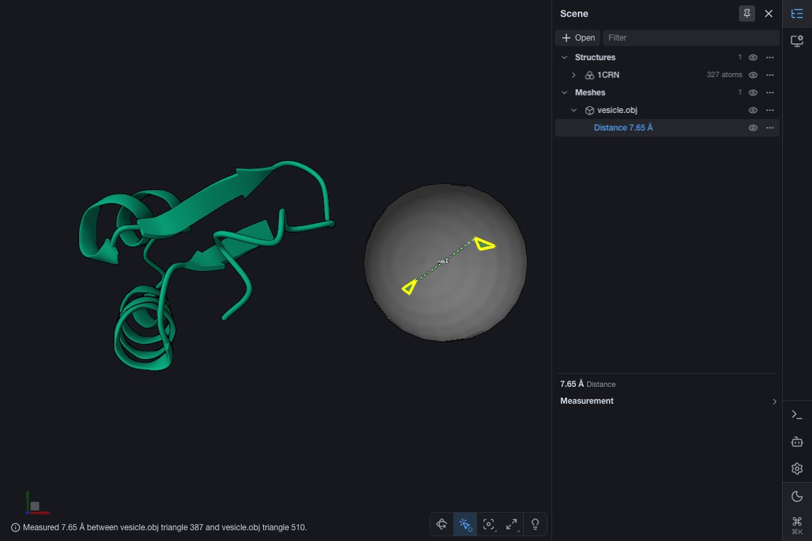
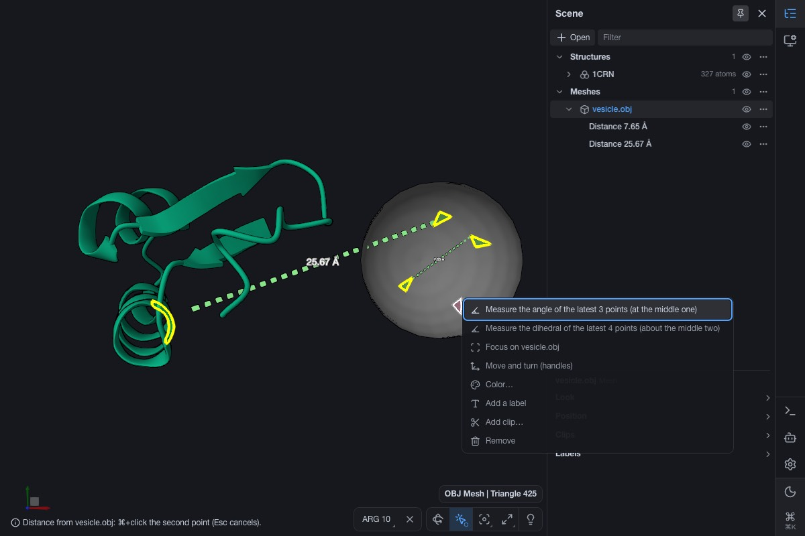
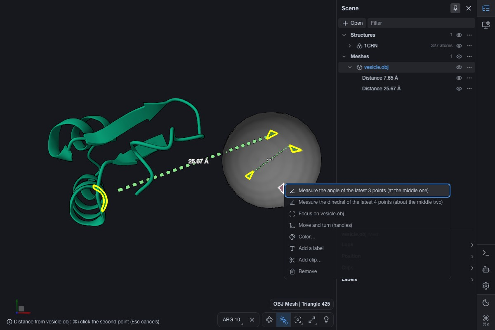
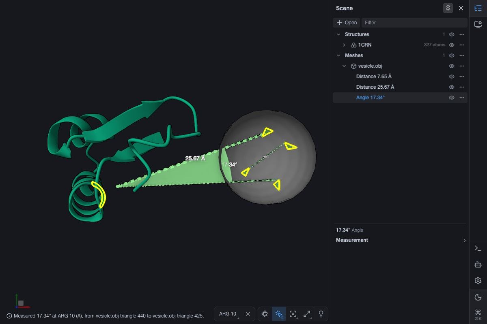
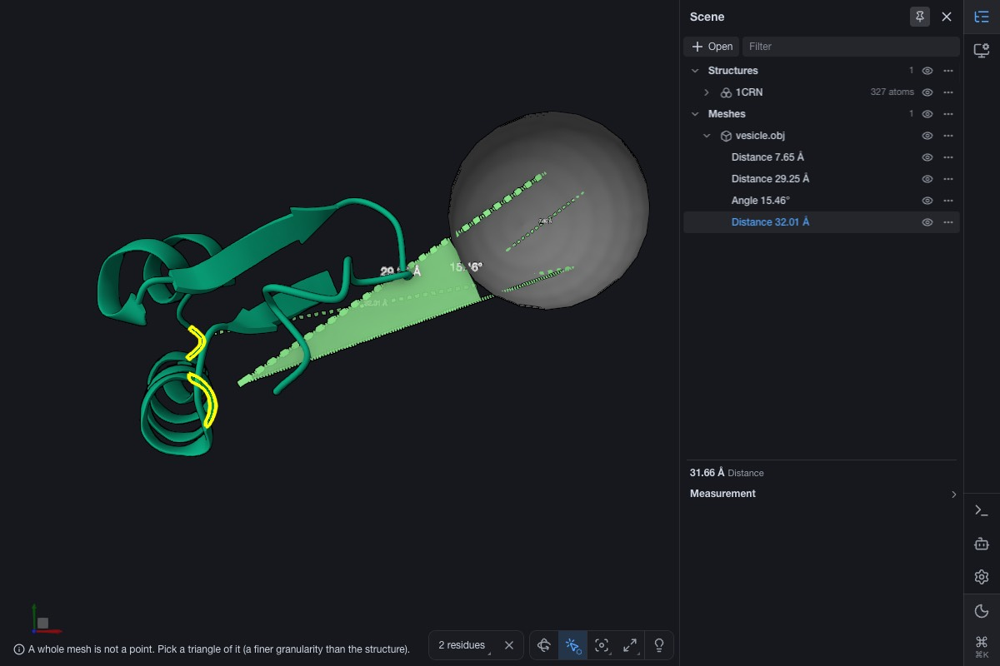
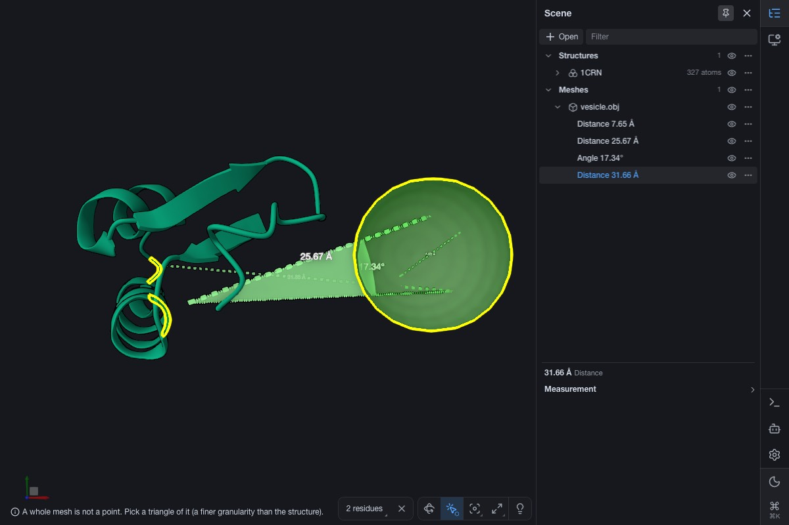
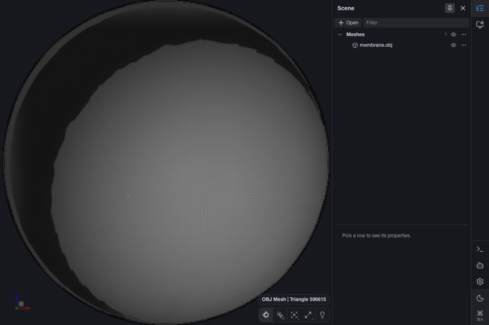

# Measurements on meshes, per triangle (lane `mesh-measure`)

Branch `me/mesh-measure` from `origin/prism-me` (after #28). Worktree `~/prism-me-lanes/mesh-measure`. Dev port 1364.

## Why (Ludo, 2026-10-31)

"make another lane that will take care of the measurement between obj/shape at the triangle highlight/selection and
other selection. Right now, mesh selection is global not at the triangle level."

## What is known (from a first read; check it)

- OBJ, PLY and VTP meshes load as shapes (`packages/graphics/src/formats/shape/obj.ts`, `ply.ts`, `vtp.ts`,
  `common.ts`).
- Their pick groups are not triangles:
  - OBJ: one group per material, or one per vertex position when the file has vertex colors (`obj.ts` around line 211
    and 264).
  - PLY: a vertex property such as `atomid` or `material_index`.
- So hover, highlight and select take a whole material or the whole mesh.
- Prism's measurements (`packages/prism/viewer/src/features/measurements/operations.ts`) take only
  `StructureElement.Loci`, i.e. atoms.
- Mol*'s measurement representations are in `packages/graphics/src/repr/shape/loci/` (distance, angle, dihedral, label).
  They are built on `Loci` and bounding spheres or centers. A `ShapeGroup.Loci` has a center through its bounding
  sphere.

## Do

1. **Triangle picking on meshes.** Hover, highlight and select of OBJ, PLY and VTP meshes at the triangle: one pick
   group per triangle, or a pick that resolves to the triangle and its hit point, without losing what the groups do
   today.
   - Today a material or vertex group gives the colours and the per-segment looks of the cryoet meshes.
   - Pick the state-of-the-art way that keeps colors, memory and drawing cost in check on large segmentation meshes
     (millions of triangles), and measure it.
   - Whole-mesh select must stay easy (for example click selects the triangle, and the existing whole-object actions
     stay).
2. **The point measured on a triangle.** Choose from the state of the art and write the reason in this file. Candidates:
   - the picked surface point;
   - the triangle's centroid;
   - the nearest vertex.
3. **Measurements between any picks.** Distance, angle and dihedral between:
   - a mesh triangle and a mesh triangle;
   - a mesh triangle and atoms;
   - a mesh triangle and a particle;
   - and the existing atom-to-atom ones, unchanged.

   Through Prism's measurement operations, the selection and the UI, with labels. The measurement must follow the mesh
   when it moves (Position handles, scale).

4. **Tests.** A failing test first for each step. Run headless in Chrome on WebGPU and WebGL2:
   - load a mesh and a structure (`data/examples` or a small OBJ made in the test);
   - hover a triangle: only it highlights;
   - select two triangles and measure;
   - measure a triangle against an atom.

   Screenshots go in this file.

5. Say which parts are library changes that could go upstream, and which are prism-me.

## Rules

- Never rebase; merge. Never push to upstream molstar/molstar.
- Commit messages say "Ludo" and end with `Co-Authored-By: Claude Opus 5.5 <noreply@anthropic.com>`. Push after each
  commit.
- Tests with `--maxWorkers=2`, no parallel suites. Stop your dev server when done. Another lane (`decorate-transform`,
  port 1363) runs at the same time: do not use its port or worktree. Ludo's live server is 1343: do not use it.
- Do not touch `current.md`.
- The gate before the PR:
  - `npx tsc -b`;
  - `npx tsc --noEmit -p apps/prism-me`;
  - lint and format:check;
  - `node scripts/workspace/assets.mjs`, then check:workspace;
  - the unit tests of the packages touched;
  - test:scaling;
  - styles:check and typecheck:storybook.

  Then the lane-reviewer, then the lane-skeptic.

- Then `gh pr create -R corredD/molstar-proto --base prism-me`. The PR body ends with
  `🤖 Generated with [Claude Code](https://claude.com/claude-code)`. Do not merge.

## Built

1. **Triangle picking** (library; .v6/plans/gl/triangle-picking.md). The GPU pick still gives the object, the instance,
   the group and the depth point; `Canvas3dInteractionHelper.getLoci` narrows a group pick of a shape that opted in
   (`Shape.getTriangleLoci`, `enableTrianglePicking`; OBJ, PLY and VTP do) to the triangle under the pointer: the
   pointer's ray (the eye through the depth point) against the triangles near the depth point, the hit nearest to the
   depth point, else the nearest triangle. The loci is a `ShapeGroup.Loci` with `triangles` (`{ instance, index, uv }`),
   so what reads only `groups` (the gizmo, MVS, labels) is unchanged. A shape representation marks a triangle loci by
   itself: copies of the highlighted and selected triangles, in their group's color with Mol\*'s marker, a hair off each
   side of the surface, one render object made empty with the representation, not pickable; never the group. Marks stay
   through a move or scale of the mesh. Whole-mesh select: Mol\*'s `structure` granularity turns the pick into the whole
   shape (one click), and the existing object actions (the row, its menu) are unchanged.
2. **The point on a triangle**: the picked surface point, kept as barycentric weights of the triangle in the mesh's
   space and evaluated through the current instance transform (decided below).
3. **Measurements between any picks** (stage-tools, prism-me): `stage.distance` takes a triangle pick; `stage.angle` and
   `stage.dihedral` are new (⌘K commands, agent tools `measure_angle`, `measure_dihedral`). One cell kind for the three
   (`StageDistance` with optional third and fourth points: old sessions open), drawn by Mol\*'s distance, angle and
   dihedral representations; depends on its objects, so moving or scaling the mesh (`stage.move`, `cryoet.mesh` scale:
   the shape provider's transforms) re-evaluates it. In the explorer: ⌘/Ctrl+click triangles as any point (two make a
   distance, as before); the canvas's right-click offers "Measure the angle of the latest 3 points" and "… the dihedral
   of the latest 4 points"; rows say "Angle 17.34°", the properties' header names the kind.

## Decided

- **The GPU picks the group, the CPU finds the triangle; marks are copies** (state of the art for picking without
  `primitive_id`: an ID buffer for the object, a CPU raycast against a spatial index for the element, as three-mesh-bvh
  and ParaView's cell picking; WebGL2 and core WebGPU have no primitive id). One group per triangle was measured on
  paper and rejected: a flat group is the provoking vertex's (the last in WebGL, the first in WebGPU), an indexed closed
  mesh has half as many vertices as triangles, so it needs an unindexed mesh (84 MB of vertices against 14 MB at 1 M
  triangles), and vertex colors would stop interpolating.
- **The picked point** (brief step 2), as ChimeraX's surface markers and 3D Slicer's model markups: it is where the
  person clicked; a centroid is up to half a triangle away, a vertex up to an edge. Stored as `uv` on the triangle, so
  it follows moves and scales exactly and is saved in a session. Its bounds' center is the point, as Mol\*'s measurement
  representations measure between centers; the radius reaches the triangle's vertices (the text's size).
- **Not Prism's `measure.*` operations** (the brief's "through Prism's measurement operations"): Prism's area is Mol\*'s
  `StructureMeasurementManager`, which takes structure loci only (`StructureSelectionFromBundle`); prism-me already
  measures particles and voxels through stage-tools (2026-10-24, measure-distance), so triangles, angles and dihedrals
  go there too. Atom-to-atom through Prism's `measure.*` is untouched.
- **Angle and dihedral from the latest points** (the classic Mol\* "from the latest picks", Prism's `measure.*` without
  targets) by the right-click: the approved two-⌘+click distance is unchanged; a third gesture would collide with it.
- **A compact grid, not `GridLookup3D`**: the counting sort keeps 6 bytes a triangle against 20 and builds 12× faster
  (measured below).
- **A triangle much wider than the rest is not in the grid** (Ludo's lane, the hover must stay local): the query grows
  by the widest triangle the grid holds, so one floor under a fine surface made every hover test all 4,097 triangles.
  Wider than 8 times a typical triangle, it is tested on every pick (the widest 64); the grid then searches with the
  widest of the rest, and one of the wide ones is still found far from its centroid. A mesh of one size is unchanged.
- **Opt in per shape**: Mol\*'s planes, boxes, gizmo handles and the measurement shapes are meshes whose groups are
  their meaning. A mesh point on a shape that did not opt in (a unit cell) is refused.

## Measured

M1 Max, Chrome headless on Metal, a UV sphere of radius 500 Å (a membrane's density), one material.

| Triangles | Lookup build | Lookup bytes          | Mesh's own (CPU) | A pick (p50 / p95) |
| --------- | ------------ | --------------------- | ---------------- | ------------------ |
| 1 M       | 24 ms        | 6.0 MB (6 B/triangle) | 26 MB            | 30 µs / 76 µs      |
| 4 M       | 86 ms        | 24 MB                 | 104 MB           | 47 µs / 120 µs     |

(`triangle-pick-scaling.test.ts`, heavy lane, `TRIANGLE_PICK_N=1000000`; with `GridLookup3D`: 297 ms and 20 MB at 1 M.)
In the app with 1 M triangles, on WebGPU and WebGL2: the narrowing under 0.1 ms p95 a hover; the same triangle indices
found on both backends; frames 16.7 ms p50 with and without a highlighted triangle (vsync); one more draw call. Pointer
move to hover event, median of 12: 46 ms by group (one material: nothing changes, no redraw) against 57 ms by triangle
(each move moves the highlight); the first hover builds the lookup, and on WebGL2 compiles the copies' program (280 ms
once).

## Tests

- core `ray3d.test.ts` (intersectTriangle); model `shape-triangle.test.ts` (equality, bounds, label, granularity);
  graphics `triangle-pick.test.ts` (the hit nearest the depth point, the miss, the cache, a moved and scaled instance),
  `triangle-marks.test.ts` (only the triangle marked, hover moves, toggles, a move keeps the marks, a group-picked mesh
  as before), `formats/shape/_test/triangle-picking.test.ts` (OBJ and PLY opt in, the wireframe does not),
  `triangle-pick-scaling.test.ts` (heavy: n and 4n, linear, bytes, pick time); stage-tools `mesh-measure.test.ts`
  (triangle–atom, triangle–triangle and "already", following `stage.move` and a scale, angle and dihedral, triangle–
  particle, the whole mesh refused); prism-me `explorer/_test/mesh-measure.test.ts` (⌘/Ctrl+clicks on triangles, the
  angle and dihedral of the latest points, let go). The existing atom-to-atom tests pass unchanged.
- Headless Chrome on WebGPU and WebGL2 (port 1364, 1CRN and an OBJ sphere made in the page), real mouse and ⌘+clicks in
  selection mode: hover a triangle (only it highlights), two triangles selected and measured (7.65 Å), a triangle to ARG
  10 (25.67 Å), the angle from the right-click (17.34°), the mesh moved 8 Å: 29.25 Å and 15.46°, the triangle-to-
  triangle distance unchanged.

## Screenshots

| WebGPU                                                                     | WebGL2                                                                     |
| -------------------------------------------------------------------------- | -------------------------------------------------------------------------- |
|          |          |
|                        |                        |
|            |            |
|               |               |
|                        |                        |
|                        |                        |
|  |  |

Rechecked on the final head (after the third review, both backends, port 1364): the same values (7.65 Å, 25.67 Å,
17.34°; moved 8 Å: 29.25 Å, 15.46°); after the angle, the unpaired triangle 425 and the next click (GLY 20) make 31.66 Å
(Grok's `1a37f84d8`); the angle keeps each point's row (the mesh's, CRAMBIN's, the mesh's: `d47a9e7df`); a ⌘+click at
the `structure` granularity on the mesh makes nothing (`0e071b62e`).

A million triangles, one hovered: 

## Library or prism-me

- **Library, upstream candidates** (commits that name no extension): core `Ray3D.intersectTriangle`; model
  `ShapeGroup.Loci.triangles`, `Shape.getTriangleLoci` and `getTriangleBoundingSphere`, the label; graphics the triangle
  lookup, `enableTrianglePicking`, `triangleLoci`, the interaction helper's narrowing, `TriangleMarks` in the shape
  representation, OBJ/PLY/VTP opting in. Listed in TODO.md, Library fixes ready for upstream.
- **prism-me**: stage-tools (triangle points, `stage.angle`, `stage.dihedral`, commands, skill) and the explorer
  (picker, right-click, rows, properties).

## Size

Production about 1270 lines added, 150 removed (library about 790 of them); tests about 990. The brief gave no size.

## Open

In TODO.md (Backlog, "Meshes by triangle"): live follow during a drag, picks during a preview move, overpaint and focus
by triangle, selected triangles outside Prism's Selection tab and sessions, a vertex-colored triangle's mark color. Wide
triangles: ended by the size grades (third review, fix 1; a floor of 1,058 wide triangles costs a pick nothing more at 1
M and 4 M), so the Backlog item 0d74a346b removed stays removed.

## Review

Two passes. The wide-triangle findings were reproduced by a failing test, then fixed. The app findings were confirmed by
the skeptic (5 of 5), then fixed the same way. Left open from this gate: the 64-triangle limit of the wide list (found
by the third review below, now fixed).

| Finding                                                                                                                | Severity   | Verdict          | Commit      |
| ---------------------------------------------------------------------------------------------------------------------- | ---------- | ---------------- | ----------- |
| The pick grid's box stayed the wide centroid, so a floor centered off the surface made every hover read every triangle | must-fix   | confirmed, fixed | `582c8d038` |
| A highlight made before the mesh moved did not clear                                                                   | must-fix   | confirmed, fixed | `8269e9585` |
| A triangle picked before a move, scale or recolor was refused                                                          | must-fix   | confirmed, fixed | `e2c6fb4e8` |
| An angle and a dihedral stored only the first point's row                                                              | must-fix   | confirmed, fixed | `d47a9e7df` |
| Measuring an angle dropped the unpaired point, so the next click did not complete its distance                         | should-fix | confirmed, fixed | `1a37f84d8` |
| At structure granularity a click on a whole mesh started a distance                                                    | should-fix | confirmed, fixed | `0e071b62e` |
| "An dihedral", and changing an angle said "distance"                                                                   | nit        | confirmed, fixed | `7d52b4af8` |

An earlier gate on this branch is already in the commits: NaN triangles, a wireframe-only mesh, the triangle's own
group, reused mark buffers, the pointer ray, an angle's clicks also making their distances, a session's old distance,
and the wording nits from that pass.

## Who did what

- Claude (Opus, this lane's agent): the lane up to `1b97f6fdf` (the build, the first gate, the first reviewer and
  skeptic pass and their fixes, the #29 merge), and the third review's fixes below.
- Grok, another agent, took the lane over while Claude was stopped on the spend limit (12:34–13:19) and opened PR #31
  (13:27): `4b4d86cf3`, `0d74a346b`, `5a76e72e6`, `582c8d038`, `8269e9585`, `e2c6fb4e8`, `d47a9e7df`, `1a37f84d8`,
  `0e071b62e`, `7d52b4af8`, `9031a7bb2`. Those commits are reviewed by the third review only.
- Commit hygiene in Grok's commits, left as they are (history is never rewritten): `5a76e72e6` and `9031a7bb2` have
  code-like titles but touch only this progress file; `7d52b4af8` also carries the Prettier reflow of `e2c6fb4e8` and
  `0e071b62e`.

## Third review (independent, range `1b97f6fdf..9031a7bb2`): 0 must-fix, 5 should-fix, 3 nits

| Finding                                                                                | Severity   | Fixed by (Claude)                                           |
| -------------------------------------------------------------------------------------- | ---------- | ----------------------------------------------------------- |
| 1. The wide list stopped at 64: 72 wide triangles brought back 2,294 tests a pick      | should-fix | size grades, each its own grid; a test of 72; a heavy guard |
| 2. Docs: the TODO item removed, "Nothing left open", the design note's Open            | should-fix | the design note, this file, the changelog                   |
| 3. `sameDrawnMesh`'s file fallback never reached (the same Mesh is refilled), too wide | should-fix | the fallback removed, the comment true                      |
| 4. `8269e9585`'s bare-representation retarget had no test failing without it           | should-fix | a test of a bare `ShapeRepresentation` (fails without it)   |
| 5. ui.md §7 did not say the unpaired point stays, nor each point's row                 | should-fix | ui.md §7                                                    |
| Nit: the heavy guard and the cost table not rerun; the build's transient bytes         | nit        | rerun, the table and the changelog updated                  |
| Nit: commit hygiene                                                                    | nit        | noted above                                                 |
| Nit: an exact tie went to a wide triangle by visit order                               | nit        | ties go to the lower triangle index                         |

The 72-triangle test asserts the triangles a pick tests (`MeshTriangleLookup.lastVisited`, new), which the old code did
not have; the reviewer's probe (2,294 tests) is the failing case it stands for.

## Fourth review (Claude's reviewer and skeptic on the third review's fixes, range `9031a7bb2..af6dc6932`)

1 must-fix, 2 should-fix, 3 nits; each fixed with a test that failed first, but M1 (its test hangs the old build until
it runs out of memory: the reviewer's probe, not rerun).

| Finding                                                                                                   | Severity   | Fixed                                                                                           |
| --------------------------------------------------------------------------------------------------------- | ---------- | ----------------------------------------------------------------------------------------------- |
| M1. A vertex at 1e20 overflows the 32-bit reach to Infinity, the grade loop never ends (out of memory)    | must-fix   | finite as stored (`Math.fround`), grades bounded (±16); a test                                  |
| S2. The cached lookup kept the reaches (4 B/triangle beyond `byteCount`) through a shared closure context | should-fix | the build in a function of its own; measured: retained = `byteCount`                            |
| S3. An RMS "typical" let wide triangles above ~6 % of the mesh into the fine grade (3,729 tests a pick)   | should-fix | grades on both sides of the median reach; a 44 % floor test (1,553 tests before, under 100 now) |
| Nit: the build's transient bytes and "the mean"                                                           | nit        | the design note: about 29 B/triangle, the median                                                |
| Nit: the screenshot table's last row broken                                                               | nit        | fixed                                                                                           |
| Nit: only OBJ tested for a pick kept across a move or a recolor                                           | nit        | a PLY test across a move and a scale (VTP by reading: its getter keeps `_mesh`)                 |

The build is slower with the grades: 44 ms at 1 M (from 24–26 ms before them), once, at the first hover.
